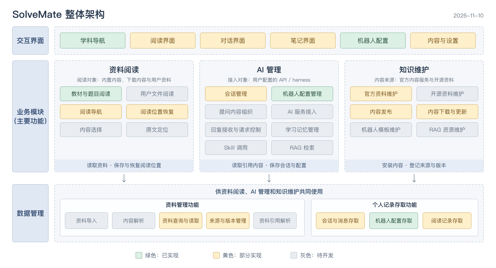

# SolveMate 整体架构

> 当前可运行范围：内置教材与题目阅读、本地会话与机器人配置保存、PWA 离线重开及官方课程下载更新。已接入本机 DeepSeek Harness、Hermes 与 Codex 的真实提问、追问和会话恢复，007 已提供用户 PDF/PPTX 导入、原页面阅读、页码及选段文字引用。

2026-11-10 已确认的整体架构图与模块、主要功能划分见本文“模块架构”。功能的实现状态分别标注；后文列出的接口、存储与运行细节仍需继续设计。

## 产品形态

SolveMate 面向学生的自主学习与教师的智能备课，按长期发展的学习客户端设计。首版通过网址访问，并支持安装为 PWA；后续考虑桌面客户端、手机 App 和小程序。所有程序、共享代码和正式文档保留在同一个 SolveMate 仓库中。

产品以资料为主干，围绕资料形成与 AI 的对话、笔记等衍生内容。这一指导思想用于后续模块协作与数据关联的设计，重点是保留资料与相关学习内容之间的关系。

客户端负责学习内容的使用、本地记录和 AI 接入。官方服务目前提供课程目录、版本查询与课程包下载；机器人模板、RAG 资源等其他内容类型尚未接入。基础示例内容随应用构建，也可从官方服务下载更新；课程内容和个人记录分别保存在终端本地。

## 资料与学习记录

资料按稳定编号组织，学科用于分类；资料改名或移动不改变其身份。对话保留主要资料与逐条引用，笔记记录来源位置，版本、页码、章节或题号由各条记录保存。资料的相关内容由这些原记录查询生成，不另存一套关联状态；查看关联不合并不同版本的会话，也不改变 Harness 绑定。具体规则见 [015](../features/015-material-learning-relations/design.md)。

## 技术选择

| 部分             | 首版方向                           | 选择理由与边界                                                                                               |
| ---------------- | ---------------------------------- | ------------------------------------------------------------------------------------------------------------ |
| 界面与客户端业务 | React + TypeScript + Vite          | TypeScript 是主要编程语言，React 是界面库，Vite 负责开发与构建。界面与业务逻辑分别组织，便于后续客户端复用。 |
| 首版运行方式     | Web / PWA                          | 用户通过网址使用，应用和内容下载完成后可脱离官方服务运行。离线重开和更新提示已验证，系统级安装尚待验证。     |
| 本地存储         | 本机 SQLite 与文件；浏览器使用缓存 | 当前保存会话、机器人配置、设置、阅读选择、笔记本、笔记与标签，以及下载课程。                                 |
| AI 接入          | 独立本机服务，Python + FastAPI     | 已通过 ACP 连接 DeepSeek Harness，处理模型选项、回复、停止、权限与会话恢复；其他 API 和 harness 分别适配。   |
| 官方内容服务     | Python + FastAPI                   | 便于现有维护者开发内容服务和数据工具。实现可随需要调整，客户端依赖明确的数据格式和接口。                     |

界面配套方案沿用 Radix Primitives 与 CSS Modules，学习资料使用 PDF.js，题目与笔记使用 Markdown 与 KaTeX；PWA 缓存使用 vite-plugin-pwa / Workbox。版本由 npm 锁文件确定，测试使用 Vitest，检查使用 TypeScript、ESLint 和 Prettier。

桌面外壳、移动端与小程序框架尚未选定。本机 AI 记录已使用 SQLite；后续桌面端若迁移网页数据，需要设计导入流程。不同平台可以复用数据定义和适合复用的业务代码，界面、文件访问和连接能力按平台适配。

## 客户端与服务的技术职责

| 部分               | 负责的内容                                                                                          |
| ------------------ | --------------------------------------------------------------------------------------------------- |
| 学习界面           | 阅读、题目导航、会话、笔记、机器人配置和设置；展示请求状态与错误。                                  |
| 客户端业务         | 内容定位、会话关联、回答上下文组织、机器人选择、消息保存，以及内容版本的使用。                      |
| 平台适配           | 本地数据读写、内容下载与恢复、AI 连接。Web 阶段使用浏览器能力，后续客户端接入各自的存储与系统接口。 |
| 外部 API / harness | 按用户配置提供 AI 服务；现成 harness 保留自身的 Agent 执行和工具调度职责。                          |
| 官方内容服务       | 内容目录、版本查询与下载。联网可获取新内容，服务不可达时客户端继续使用已完整下载的版本。            |

平台适配接口需要明确读写、发送、取消、失败等行为。接口定义和 Web 实现可以先放在现有应用内，出现实际共享代码后再提取到 `packages/`，不预先扩充目录。

### 操作系统差异的处理

Windows、macOS 的系统差异由本机底层代码处理，前端和会话业务使用相同的数据结构和接口。

- `apps/local/src/solvemate_local/processes.py` 统一 Python 子进程的启动选项和进程树停止，Harness 协议通信使用该实现，其他本机命令复用相同操作；`scripts/start.mjs` 中的 `ProcessManager` 管理 Node 启动的服务进程。
- 外部程序的安装位置、原生入口与配置目录由对应适配代码处理，不向会话业务暴露系统判断。
- npm 脚本由 Node 通过 npm 提供的 CLI 路径启动，不直接执行 Windows 批处理入口。文件路径和命令参数分别传递；文本读写明确使用 UTF-8，生成文件统一使用 LF。

GitHub Actions 在 macOS 和 Windows 分别运行检查、测试和构建。2026-11-12 的提交 `025729a` 已通过双平台完整检查；第三方软件的实际安装、账号调用和桌面交互仍需实机验收。

当前本机 AI 连接位于 `apps/local/`，使用 Python + FastAPI。它与官方内容服务分别运行，`npm start` 统一管理网页和两个 Python 服务；未来桌面端的常驻方式随客户端设计确定。

## 本地数据与离线行为

各模块的共享对象、字段归属、配置与历史快照、事务和迁移约束见[模块元数据与数据结构设计](metadata.md)。AI 配置与对话部分已由 006 实现共享 Schema 和数据迁移，其余对象按特性逐步落实。

本项目中的“离线”指终端无法连接 SolveMate 官方服务。此时不能获取新的题库或知识库，但已完整保存的内容、会话和配置继续可用。AI 连接状态单独判断：用户的 API 或本机 harness 可达时，仍可进行对话。

需要分别管理两类本地数据：

- 应用资源：页面程序、样式、字体、公式渲染所需资源等，确保脱离官方服务后仍能重新打开应用。
- 学习数据：已下载的教材、题目、课程记忆，以及会话、消息、笔记、机器人配置和用户设置。

内容编号保持稳定，下载内容携带版本信息；本地数据库结构也有独立版本。内容更新失败时保留原有可用内容，应用更新和数据库升级应保留个人记录。当前按整门课程的固定版本 ZIP 更新，导出与迁移格式尚待设计。

正式学习记录由本机服务保存在 `user/`，浏览器的 IndexedDB 只保存缓存和未确认修改。写入检查记录版本，失败保留旧值；浏览器迁移先备份再导入，原数据不删除。断开本机服务时可查看缓存，修改不宣称已保存。跨设备同步、通用备份导入和自动备份另行设计。

## AI 连接边界

对话请求由客户端依据本地内容、当前会话和机器人配置组织，经连接适配模块发给用户配置的 API 或 harness。该流程应能脱离 SolveMate 官方服务运行。

浏览器可直接连接的服务需要提供合适的网络接口，并允许跨域访问。本机服务还可能涉及浏览器的本地网络访问许可。当前本机启动方式通过同源代理访问 `apps/local/`，再以子进程连接 DSH、Hermes 或 Codex。公网网页与本机服务的配对尚未实现。

在线 API 会接收回答所需的问题与材料上下文。个人记录的本地保存和请求发送范围分别设计；连接凭据不得混入内容下载请求、常规日志或普通数据导出。

客户端应用的会话编号与外部 harness 的会话编号分别管理。适配层明确二者的对应关系、消息归属和取消行为，避免将外部运行时的内部结构直接作为所有客户端的数据格式。ACP 绑定、每轮配置快照和失败恢复见 [003 设计](../features/003-ai-harness-connection/design.md)。

### 对话规则与 Harness 适配

设计先确定业务操作成立的必要条件，再分配实现职责。现有四个模块和工程目录保持不变；共用的数据定义、配置解析、适配器与事务分别解决实际的一致性、协议差异和保存问题，不为尚未出现的差异增加结构。

| 对象或操作         | 判断依据与职责                                                                                                                         |
| ------------------ | -------------------------------------------------------------------------------------------------------------------------------------- |
| AI 服务选择        | 本机服务保存外部连接，教师和对话引用同一连接目录；全局默认只决定尚未独立配置的选择                                                     |
| 正式会话恢复       | 公共服务提供原生编号与保存的工作目录，适配器恢复原会话并核对结果；程序和配置目录变化本身不使会话失效                                   |
| 连接检测           | 专用测试会话与正式对话分别处理；测试会话丢失不使整项连接失效，连接中断、超时等实际故障保留各自原因                                     |
| 配置保存与回复接收 | 保存操作在事务成功后发布配置，回复按执行编号与版本合并；历史结果不覆盖当前配置                                                         |
| 官方内容更新       | 下载、校验和保存完成后切换当前版本，失败保留旧内容与历史引用                                                                           |
| 数据刷新与冲突     | 统一读取最新记录，按基线比较本页修改；冲突需确认，表单和提问草稿保留，不自动重复写入，见 [013](../features/013-data-refresh/design.md) |

这些约束直接落实在现有业务操作和适配器中。会话是否可继续，最终以原生恢复结果为依据；本地记录仍用于查找会话、显示历史和检查请求归属。

对话规则以 DeepSeek Harness 的实际会话管理行为和接入验证为依据。先完成 DSH 适配并形成共同规则，后续接入其他 Harness 时，由各自适配器转换接口和事件，继续使用同一套会话管理与显示逻辑。只有经过验证、确实无法兼容且有必要的差异，才提出规则调整，说明影响并经讨论确认；不因新增服务直接改变已有对话行为。DSH、Hermes 与 Codex 已分别通过适配器接入，共用连接、对话与执行管理；原生标题、重命名和归档同步仍待实施，见 [004 设计](../features/004-hermes-harness-adapter/design.md)。

- 一条正式对话固定关联一位教师、一项 Harness 连接和一个原生 session。首次实际提问时建立外部绑定；追问、刷新和服务重启沿用或恢复该 session。恢复失败时保留记录并显示原因，不自动另建 session。
- 模型按每轮提问选择并记录，切换同一 Harness 内的模型不重开会话。切换教师或 Harness 服务时，按已确认文案提示确认；确认后开始新对话，保留原对话和绑定，取消则保持原状。
- 原生会话身份、执行状态与服务侧已确认的管理结果由 Harness 提供；SolveMate 保存对应关系、展示与离线所需记录，以及教师关联、资料引用和学习标签等扩展信息。服务不可达时，已有本地记录仍可查看。
- 会话标题、重命名和归档等管理行为尽量与 Harness 一致。适配设计应明确读取、提交、确认及外部变更的处理方式。只保存本地修改不能视为已同步到 Harness；当前本地命名、归档和隐藏行为与原生管理的差异需要逐项处理。
- 会话管理和界面使用统一的操作结果、执行状态、正文更新、工具与权限事件。具体适配器负责启动、检测、原生会话编号、模型选项、提问、停止、权限与事件转换，不要求页面识别 DSH 或其他服务的原始通知。
- 需要会话才能检测的服务复用一个专用连接检测会话；Codex 通过配置与模型查询完成检测，不创建 thread；检测并发、重试和保存前复检不得反复创建。该会话与正式学习对话分别记录，创建结果不明或恢复失败时先核实原因。

DSH 完整的会话管理行为与 ACP 暴露的接口分别核对，不能将 ACP 的缺失项直接解释为 DSH 不支持。当前接口差异、待验证内容及实施顺序见 [003 设计](../features/003-ai-harness-connection/design.md#dsh-适配范围与接口差异)。

Codex 的 app-server 接口与跨协议公共接口见 [005 设计](../features/005-codex-harness-adapter/design.md)。公共会话服务只处理统一结果和事件，原生协议的方法名、请求确认、正文校正与权限响应保存在适配器中。

## 当前阶段与后续

当前支持内置教材与题目阅读、个人记录保存、PWA 离线重开，以及官方课程目录、版本和下载更新。DeepSeek Harness、Hermes 与 Codex 接入已在 macOS 验证，Windows 已提供启动适配和自动测试，实机验收待有环境时进行。007 已完成有文字层 PDF 和 PPTX 的导入、阅读及文字引用，PPTX 由本机 LibreOffice 转换。备份等功能保留为候选，事项与范围见[项目计划](../../PLANS.md)。已确认的模块与主要功能划分见本文“模块架构”。

教研室面向教师，规划以 AI 辅助讲义研发、试题精讲和试题研发。当前已提供可展开的菜单及三个页面入口；具体流程、数据结构和与现有模块的协作方式见[项目计划](../../PLANS.md#教研室)，后续讨论后再确定实现范围。现有四个模块及工程目录保持不变。

## 当前实现

- `apps/server/src/solvemate_server/` 提供官方内容 API 和发布工具，源文件白名单位于 `data/catalog.json`，接口通过 OpenAPI 共享；个人记录不进入此服务。

- `apps/web/src/components/` 实现阅读、对话、笔记、机器人、导航、设置和学习统计展示，样式使用 CSS Modules。
- `apps/web/src/theme/` 集中定义界面颜色、默认日间与夜间配色，以及主题校验和应用函数。组件引用公共变量；可配置范围和后续接入约定见 [009 主题配色](../features/009-theme-configuration/design.md)。
- `apps/web/src/data/` 直接导入仓库现有的教材、题库和课程记忆，提供内容查找、示例记录及数据校验。
- `apps/web/src/content/` 负责内容 API、ZIP 校验、下载状态和课程缓存；正式课程包位于 `user/community/`，版本索引和当前指针由本机 SQLite 事务提交，历史版本保留。
- `apps/web/src/storage/` 提供个人记录存储接口、本机 HTTP 请求、浏览器缓存及旧记录迁移。正式记录保存到 `user/app.sqlite3`；本机服务统一检查保存版本，拒绝跨浏览器的旧值覆盖。读取错误保留原数据，缓存不决定正式保存是否成功。
- `apps/web/src/state/` 管理会话关联和机器人变更，删除机器人后保留历史回复作者。
- `apps/web/src/ai/` 负责本机服务请求、配置状态、执行进度读取和消息合并；真实回复与示例消息分别标记。
- `apps/local/src/solvemate_local/` 负责 Harness 进程、模型配置、外部会话绑定、执行持久化与权限确认，数据保存到 `user/ai/`；独立的资料存取与转换文件管理 `user/uploads/`；`user_data.py` 和 `user_routes.py` 管理个人记录、下载课程与浏览器迁移。
- `packages/contracts/` 定义共享数据；AI 配置与对话的 JSON Schema 同时用于 TypeScript 类型生成、浏览器与 Python 校验及本机接口 OpenAPI。

PWA 构建缓存应用程序、示例内容和公式字体。内置基础内容版本为 `example-1`，下载版本使用 ZIP 的 SHA-256；个人记录和本机 AI 连接管理数据结构为版本 3，执行快照保持版本 2，数据库记录的保存版本独立维护；迁移事务保留旧格式备份、记录编号、消息和原生绑定。官方内容服务已实现目录、版本、更新判断与固定版本 ZIP 下载，支持校验、缓存和断点续传；Web 已接入目录与下载更新；内容包校验并写入 `user/community/` 后，在 `user/app.sqlite3` 的事务中提交版本索引与当前指针，旧版本保留，历史会话按原版本读取。后端实现与启动说明见 [002 设计](../features/002-official-content-service/design.md) 和 [服务说明](../../apps/server/README.md)。

2026-11-06 的开发验证中，构建、类型检查、代码检查、格式检查、57 项网页测试和 6 项构建补丁测试通过。浏览器交互和停止本地预览服务器后的离线重开验证结果见[项目计划](../../PLANS.md)。系统级安装及其他浏览器兼容性仍需后续验证。

当前验证包含关闭页面后恢复已保存记录、内容更新失败后继续阅读原版本。003 已验证真实提问、追问、停止、网页刷新和服务重启后的同会话恢复；本地数据导出与恢复仍待实现。当前命令见根 README；系统级安装与更多浏览器兼容性仍待验证。

## 参考资料

- [React 与 Vite 项目构建](https://react.dev/learn/build-a-react-app-from-scratch)
- [Dexie 本地数据库文档](https://dexie.org/docs)
- [Vite PWA](https://vite-pwa-org.netlify.app/guide/)
- [浏览器存储与持久化](https://developer.mozilla.org/en-US/docs/Web/API/Storage_API/Storage_quotas_and_eviction_criteria)
- [Chrome 本地网络访问](https://developer.chrome.com/docs/modern-web-guidance/guides/security/local-network-access?hl=en)
- [FastAPI](https://fastapi.tiangolo.com/features/)

001 阅读助手的具体范围和交互见[特性规格](../features/001-instant-question-answering/spec.md)，该特性的流程与验收实现见[技术设计](../features/001-instant-question-answering/design.md)。

## 依赖安全修复

2026-11-06：18 项 npm 告警来自 4 个底层依赖问题。根 `package.json` 的 `overrides` 将相关依赖统一到修复版本，保留现有 React、Vite、ESLint 与 PWA 插件主版本。

| 依赖      | 原版本  | 当前处理                                                                               |
| --------- | ------- | -------------------------------------------------------------------------------------- |
| KaTeX     | 0.16.47 | 0.19.1；同时覆盖 rehype-katex 和数学解析插件内部引用                                   |
| minimatch | 10.2.6  | 受影响的 7–11.0.0 使用 11.0.5；未受本次告警影响的 5.x 不变                             |
| glob      | 11.1.0  | 受影响的 9–14.0.1 使用 14.0.4                                                          |
| deepmerge | 4.3.1   | 使用 [本地安全补丁](../../packages/deepmerge/README.md)，保留上游 MIT；仅用于 PWA 构建 |

KaTeX 修复[继承配置绕过](https://github.com/advisories/GHSA-238p-pmpm-9mq7)，minimatch 修复[模式放大](https://github.com/advisories/GHSA-g3hv-75wg-m249)，glob 修复[取消信号绕过](https://github.com/advisories/GHSA-3g3m-2fjr-6pw4)。[deepmerge 公告](https://github.com/advisories/GHSA-gcqx-w48m-w2h4)当前没有修复发行版，本地副本同时保护两条属性复制路径；漏洞复现和兼容性测试纳入 `npm test`。上游提供修复版本后重新验证并移除补丁。

`overrides` 超出了部分上层包声明的依赖范围，更新这些上层包时，应重新核对范围与接口兼容性，兼容后移除对应 override。验证使用实际安装树、完整生产构建、公式渲染、PWA 离线与内容下载；没有通过忽略告警或 `audit-level` 阈值减少报告数量。检查环境为 Node.js 24，最低 Node 版本调整为 22.13.0，以符合现有 ESLint 的要求。

## 模块架构

确认日期：2026-11-10。当前版本已确认整体架构图、模块与主要功能的划分，以及特性全局管理和跨模块实现的关系。后续设计与特性开发以此为依据。

各功能的实现范围见“进度核对”，工程目录、服务职责及存储方式见“当前实现”。首版用户文件类型、接口与保存方式见 [007](../features/007-personal-materials/design.md)；本机 AI 服务与适配器见 003–006。

### 使用方式与设计范围

用户在 Windows 或 macOS 下载 SolveMate 源码，将项目路径交给自己的 AI 工具，由该工具协助完成依赖安装、配置和启动。用户随后在浏览器导入自己的资料，阅读内容，并围绕当前页面或选区与 AI 讨论。协助启动的 AI 工具与应用运行时接入的 AI 服务分别配置，二者能否复用同一个 harness 需要验证。

### 模块、功能与特性

模块划分系统职责，模块内部承载主要功能。功能由一个或多个特性逐步实现，同一个特性也可以同时支撑多个模块中的功能。特性使用全局编号，文档记录需求、涉及的模块与功能、跨模块协作、前置依赖和验收标准。

架构图中的模块边框表示职责范围，小方块表示主要功能。特性在交付时关联这些功能，文档继续保存在 `docs/features/`，编号在整个项目中统一管理。已有代码工程和文档目录保持不变。

### 模块职责与主要功能

| 模块     | 主要功能                                                                                                       | 职责边界                                                                                                             |
| -------- | -------------------------------------------------------------------------------------------------------------- | -------------------------------------------------------------------------------------------------------------------- |
| 资料阅读 | 教材与题目阅读、用户文件阅读、阅读导航、阅读位置恢复、内容选择、原文定位                                       | 决定如何呈现内容、跳转到哪里及当前选区；通过数据管理读取资料、保存和恢复位置记录                                     |
| AI 管理  | 会话管理、机器人配置管理、提问内容组织、AI 服务接入、回复接收与请求控制、学习记忆管理、Skill 调用、RAG 检索    | 决定会话与机器人规则，组织问题、资料引用和必要历史；调用用户配置的 API 或 harness；记录消息、引用和执行状态          |
| 知识维护 | 官方资料维护、开源资料维护、内容发布、内容下载与更新、机器人模板维护、RAG 资源维护                             | 维护公开内容、来源与授权、发布版本和获取方式；将内容交给数据管理安装；已安装的本地机器人配置由 AI 管理负责使用和修改 |
| 数据管理 | 资料导入、内容解析、资料查询与读取、来源与版本管理、资料引用解析、会话与消息存取、机器人配置存取、阅读记录存取 | 保存原件与派生内容，维护资料记录并执行查询和读取；按业务模块要求保存个人记录，记录的业务含义与操作规则由所属模块决定 |

阅读导航和阅读位置恢复分别表达主动跳转与恢复上次位置，两项功能独立列出。内容选择产生所选内容及来源位置，原文定位根据已有引用返回对应位置。教材、题目、机器人模板和 RAG 资源是这些功能管理的对象，图中的功能名称明确说明对它们进行什么操作。

数据管理负责读写和资料生命周期。例如，AI 管理决定会话如何归档，数据管理保存归档结果；资料阅读决定显示哪份内容，数据管理查找并读取相应资料。用户自己的上传资料不因被 AI 读取而自动成为开源资料。

学习记忆用于积累学习进展、常见疑问、已有解释和用户反馈，并为教师调整讲解方式提供依据。教师的自学习与自演进围绕其专业角色展开，涉及的记忆使用与教学调整由 AI 管理负责，记录保存由数据管理负责，公开课程内容、机器人模板与 RAG 资源的维护由知识维护负责。具体机制在相应特性中设计，产品目标见[愿景](../product/vision.md#22-长时记忆与教师的自学习自演进)。

安装、启动和停止通过项目脚本及运行说明组织。首次环境准备和跨平台验证保留在项目计划中；PWA 资源缓存属于浏览器运行机制，具体技术安排见本文件的现有实现说明。

### 特性与功能的对应

以下以已有特性说明对应关系，范围仍以各自规格为准：

| 全局特性                                                                             | 涉及的模块与功能                                                                                                                                              | 当前状态                                                 |
| ------------------------------------------------------------------------------------ | ------------------------------------------------------------------------------------------------------------------------------------------------------------- | -------------------------------------------------------- |
| [001 阅读助手](../features/001-instant-question-answering/spec.md)                   | 资料阅读中的教材与题目阅读、阅读导航和阅读位置恢复；AI 管理中的会话管理、机器人配置管理、提问内容组织及回复接收与请求控制；数据管理中的资料读取和个人记录存取 | 部分实现；真实 AI 回复由 003 支撑，AI 推荐等目标仍待实现 |
| [002 官方内容服务](../features/002-official-content-service/spec.md)                 | 知识维护中的官方资料维护、内容发布及内容下载与更新；数据管理中的资料查询与读取、来源与版本管理；通过内容管理界面提供操作                                      | 已完成当前课程内容服务和网页下载更新范围                 |
| [003 AI 配置与 DeepSeek Harness 接入](../features/003-ai-harness-connection/spec.md) | AI 管理中的服务接入、提问组织、回复和执行控制；数据管理中的会话、消息及绑定存取                                                                               | 已实现当前 ACP 连接范围，Windows 实机验收待补            |
| [004 Hermes 接入](../features/004-hermes-harness-adapter/spec.md)                    | AI 管理中的多服务配置、ACP 差异适配、检测复用与切换确认                                                                                                       | 已完成 macOS 真实调用，Windows 实机验收待补              |
| [005 Codex 接入](../features/005-codex-harness-adapter/spec.md)                      | AI 管理中的 app-server 接入、跨协议操作与事件转换、流式正文及原生执行编号                                                                                     | 已完成 macOS 真实调用，Windows 实机验收待补              |
| [006 AI 配置与对话元数据](../features/006-ai-conversation-metadata/spec.md)          | AI 管理中的配置、对话与执行记录；数据管理中的共享校验、事务与旧数据迁移                                                                                       | 已实现并验证，Windows 实机验收待补                       |
| [009 主题配色集中管理](../features/009-theme-configuration/spec.md)                  | 各页面共用的颜色定义、默认主题、日间与夜间模式，以及主题配置校验                                                                                              | 已实现默认主题与配置函数；主题选择、导入和保存尚未开放   |

例如，“针对选段提问”需要资料阅读提供内容选择、数据管理读取引用内容、AI 管理组织提问并接收回复。这类特性应统一说明跨模块协作和验收条件；该例用于说明关系，尚未分配新特性编号或确定开发范围。

图中颜色按主要功能的目标范围标记，特性状态按其规格范围判断。002 已完成课程版本的下载更新，而资料查询与读取、来源与版本管理还需要支持用户文件，因此对应功能仍标为部分实现。

### 整体架构

整体图展示 SolveMate 主要模块和功能的目标划分，以及当前实现范围。用户在本机导入和阅读资料，由 AI 管理组织问题及引用内容，调用用户配置的 API 或 harness。知识维护提供可复用的公开内容，数据管理为这些业务提供资料和记录的保存、查询与读取。

[查看矢量图](solvemate-modules.svg) · [编辑绘图源文件](solvemate-modules.drawio)

绿色表示所列功能已有可用实现，黄色表示已有基础但尚未覆盖目标范围，灰色表示尚未实现对应功能。实现范围核对日期为 2026-11-10，依据为代码与已有测试；具体范围见下方“进度核对”。示例数据、类型定义、接口占位和配置项保存均不能代替真实执行功能。

整体图由上到下展开交互界面、业务模块与共享的数据管理。资料阅读、AI 管理和知识维护下方分别说明使用数据的方式，短箭头指向共同使用的数据管理区域。阅读对象、AI 接入对象和内容来源放在对应模块中说明，具体接口另行展开。

| 业务模块 | 使用数据管理完成的操作                                       |
| -------- | ------------------------------------------------------------ |
| 资料阅读 | 查找和读取资料，保存与恢复阅读位置                           |
| AI 管理  | 读取问题所引用的文字、图片或文件，保存会话、消息及机器人配置 |
| 知识维护 | 安装内容，登记来源与版本，保存本地安装记录                   |

数据管理将主要功能分为两组：资料管理包括资料导入、内容解析、资料查询与读取、来源与版本管理、资料引用解析；个人记录存取包括会话与消息存取、机器人配置存取和阅读记录存取。这些功能由三个业务模块交叉使用，图中数据管理为横跨三个模块的共享区域。业务模块定义记录的含义与操作规则，数据管理执行相应读写。

交互界面列出用户可以进入的页面，主要功能归属按上表划分。资料与个人记录的保存、查询和读取由数据管理负责；具体路径、数据库及部署进程见“运行角色与存储位置”。

教材与题目阅读的已实现范围为现有课程的 Markdown、公式、代码和参考答案。DeepSeek Harness、Hermes 与 Codex 已提供真实 AI 回复，当前传递课程文字及用户资料的当前页或选段文字。007 提供用户 PDF/PPTX 阅读和文字选段引用；Skill、RAG 检索和学习记忆提取仍待开发。离线重开支持已缓存的页面、内置及已下载课程；用户阅读文件及读取过的页面文字另存于浏览器资料缓存。

### 进度核对

| 功能                                          | 图中状态           | 已有实现与仍缺少的部分                                                                                                                                   |
| --------------------------------------------- | ------------------ | -------------------------------------------------------------------------------------------------------------------------------------------------------- |
| 阅读界面、阅读导航                            | 部分实现           | 已有课程、教材、题目选择和上一节／下一节、上一题／下一题；007 增加 PDF/PPTX 原页面阅读、翻页、页码跳转和缩放，其他格式仍待接入                           |
| 阅读位置恢复、阅读记录存取                    | 部分实现           | 保存课程选择、用户资料版本和当前页码；返回对话或点击引用可恢复对应内容。尚无逐份资料的独立阅读历史和页内滚动偏移                                         |
| 对话界面、会话管理、会话与消息存取            | 部分实现           | 已有会话创建、标签、归档、删除、真实回复和原生会话绑定；消息保存当轮课程文字引用，007 已接通用户资料的选段和当前页文字引用，图片区域引用仍待开发         |
| 笔记界面                                      | 部分实现           | 支持笔记本管理、正文创建编辑、资料来源与本地保存；从对话提炼笔记后续设计，见 [015](../features/015-material-learning-relations/spec.md)                  |
| 机器人配置管理、机器人配置存取                | 已实现配置管理范围 | 已有机器人新建、复制、删除、默认选择、独立草稿和本地保存；模型选择用于真实调用；记忆与能力选项仍只保存偏好                                               |
| 官方资料维护                                  | 部分实现           | 已有课程源文件、白名单、格式与引用校验，可通过修改源文件维护内容；机器人模板与 RAG 等内容尚无对应维护实现                                                |
| 内容发布                                      | 部分实现           | 已有命令行课程打包与发布，生成版本包、清单和目录并保留旧版本；范围限于现有课程包，尚未覆盖机器人模板、RAG 等其他内容类型，正式部署也不在当前已验收范围内 |
| 内容下载与更新                                | 部分实现           | 已有官方课程目录、固定版本下载、校验、本地事务保存及失败保留旧版；开源资料、机器人模板和 RAG 资源的下载更新尚未实现                                      |
| 资料查询与读取、来源与版本管理                | 部分实现           | 已支持内置及下载课程的读取与版本关联，007 增加用户资料目录、固定版本与原件管理，更多来源和资料类型后续扩展                                               |
| 提问内容组织、AI 服务接入、回复接收与请求控制 | 部分实现           | 已传递教师指令、问题、现有课程文字与必要历史，支持三项 Harness 的回复进度、停止、权限确认和恢复；007 增加用户资料文字引用，其他服务和图片附件后续接入    |
| 资料引用解析                                  | 部分实现           | 已读取并保存当轮课程章节或题目文字；007 已实现 PDF 页码、文字选段及返回原文；图片区域引用尚未实现                                                        |
| 内容与设置界面                                | 部分实现           | 已有官方课程下载、显示和AI 配置；其他内容类型的管理尚未实现                                                                                              |

核对依据包括 [阅读组件](../../apps/web/src/components/Reader.tsx)、[页面状态处理](../../apps/web/src/App.tsx)、[本地加载与保存](../../apps/web/src/storage/useLocalData.ts)、[数据类型](../../packages/contracts/src/index.ts)、[课程发布工具](../../apps/server/src/solvemate_server/publish.py) 与 [002 当前规格](../features/002-official-content-service/spec.md)。`ReadingSelection` 继续描述现有课程；`MaterialLocation` 描述用户资料的固定版本和页码，两者分别保存。007 不实现页内滚动位置恢复。

2026-11-10 运行了 36 项前端测试，覆盖本地存取、会话和机器人状态、内容包与版本保存；24 项后端测试覆盖课程发布和内容 API，全部通过。测试结果验证的是现有实现范围，不表示目标功能已全部完成。

### 跨模块协作

下表描述模块之间需要提供的操作及传递内容。D1–D7 为文档引用编号，具体数据结构、函数和 HTTP 路由仍需在相应特性中确定。

| 编号 | 使用方 → 提供方                     | 传递或读取的内容                                                             |
| ---- | ----------------------------------- | ---------------------------------------------------------------------------- |
| D1   | 资料阅读 → 数据管理                 | 查询资料编号、版本、文件位置及处理状态，取得可阅读内容                       |
| D2   | AI 管理 → 资料阅读                  | 获取当次阅读引用：资料编号、版本、位置及所选文字或区域；普通对话可以不带引用 |
| D3   | AI 管理 → 数据管理                  | 根据引用读取实际文字、图片或文件，取得读取结果                               |
| D4   | AI 管理 → 数据管理                  | 保存与读取会话、消息、当次引用和执行状态                                     |
| D5   | AI 管理 → 知识维护                  | 查询机器人模板和可安装资源的信息；安装后的个人配置由 AI 管理负责             |
| D6   | 知识维护 → 数据管理                 | 提交下载的内容包和版本信息，安装并记录本地版本                               |
| D7   | AI 管理 → 用户配置的 API 或 harness | 按目标接口传递内容、附件与会话操作，接收流式回复和状态                       |

运行方式和服务进程的对应关系见后文“运行角色与存储位置”。整体图按业务职责展开；当前本机 AI 服务位于 `apps/local/`，与官方内容服务独立运行。

整体架构图提供可在 diagrams.net 中编辑的 `.drawio` 源文件，以及 SVG 和 PNG 导出文件。修改图源后应同步导出图片。图法参考 [OpenAI 的 UML and Software Architecture Visualization skill](https://github.com/openai/plugins/blob/main/plugins/build-web-data-visualization/skills/uml-and-software-architecture-visualization/SKILL.md)。

资料阅读提供选区和来源位置，AI 管理决定如何把这些内容加入当前问题。阅读器本身不处理模型鉴权和外部会话协议。AI 管理通过数据接口取得资料，不自行维护另一套原文件副本。

知识维护定义和获取可复用的内容。官方机器人模板安装为本地机器人配置后，由 AI 管理负责使用和修改；模板后续更新如何影响已修改的本地配置，仍需确定。RAG 资源的发布与实际检索调用分别设计，是否纳入首版待确认。

### 主要数据与关联

| 数据                           | 业务负责人                             | 需要保持的关联                                                   |
| ------------------------------ | -------------------------------------- | ---------------------------------------------------------------- |
| 资料及原文件                   | 数据管理                               | 稳定编号、来源、版本与文件位置                                   |
| 解析结果、页面图片等派生内容   | 数据管理；具体处理方式按格式验证后确定 | 原资料及版本、生成方式、处理状态、页码或其他来源位置             |
| 阅读位置和临时选区             | 资料阅读                               | 资料编号、版本与页面或内容范围                                   |
| 会话、消息和消息引用           | AI 管理                                | 本地会话编号、当次引用的资料与位置、所用机器人、外部会话对应关系 |
| 官方或开源内容目录、版本与授权 | 知识维护                               | 内容来源、发布版本与本地安装记录                                 |

提问引用至少需要描述“哪份资料、哪个版本、哪个位置”。位置可以是页码、幻灯片编号、文字范围或图片区域，具体支持项随首版格式和交互确定。实际发送给 AI 的内容可以是文字、图片、原文件附件或 harness 可读取的文件引用，按接入能力适配。

统一引用信息不要求所有资料先转成同一种文件。首版 PDF 使用 PDF.js 显示原页面，PPTX 由本机 LibreOffice 转换后共用阅读器；页面文字由 pypdf 提取，选段文字来自阅读器。扫描内容 OCR、图片理解和旧版 PPT 尚未接入。

历史消息保留发送时的引用信息，用户随后翻页或打开其他资料时，不改写已经发送的引用。仅保存一个 AI 无法访问的文件路径，不能视为内容已进入对话；首个接入验证需要检查 AI 实际能够读取所引用的内容。

### 运行角色与存储位置

| 运行角色               | 承担的模块职责                                            | 说明                                                                                               |
| ---------------------- | --------------------------------------------------------- | -------------------------------------------------------------------------------------------------- |
| 浏览器中的学习界面     | 资料阅读，以及资料、会话、机器人、知识内容等操作界面      | 沿用已有 Web 工程，通过本机接口读取需要访问文件或执行 AI 调用的内容                                |
| 本机服务 `apps/local/` | AI 管理中的本机连接与协议适配、数据管理中的执行和绑定存取 | Python + FastAPI，已接入 DSH、Hermes ACP 与 Codex app-server；用户文件由独立资料存取与转换代码处理 |
| 官方内容服务           | 知识维护中的官方目录、版本查询与下载发布                  | 保持现有职责，不通过此服务接收个人资料或个人对话                                                   |
| 外部 API 或 harness    | 按配置提供模型、会话或工具执行能力                        | 文件类型、接口、鉴权和可调用能力逐项验证，首版不自研 harness                                       |

上述运行角色与模块分别描述部署位置和业务职责。引入本机能力不会自动改变现有官方内容服务的接口范围；AI 连接使用独立本机进程，不复用官方内容服务处理个人对话。

目标日常运行形态建议为浏览器加本机服务，AI 使用用户配置的 API 或 harness。官方内容服务用于获取更新，不作为本地阅读和提问的必要依赖；开发或维护官方内容时，可以按需运行现有服务。

存储位置按已讨论的方向设计：

- `data/` 继续存放随代码维护和发布的官方内容源文件及公开示例，已有课程结构保持不变。
- `user/ai/state.sqlite3` 保存 AI 连接配置、绑定与执行，`user/ai/workspace/` 作为 Harness 工作目录；用户原件、阅读 PDF、按页文字和处理记录保存于 `user/uploads/`，浏览器资料缓存使用独立数据库 `solvemate-materials`。
- 当前 `user/` 及其内容纳入 Git 管理，不添加忽略规则；先不实施与项目代码的目录分离。保存位置、自定义路径与已有数据迁移是发版前需要处理的遗留事项。
- 对话、笔记、机器人、学科、标签、设置、草稿和阅读进度由本机服务保存到 `user/app.sqlite3`；官方和社区下载内容位于 `user/community/`。浏览器缓存使用 `solvemate-server-cache`，原有 `solvemate-local` 与 `solvemate-content` 数据库保留供迁移和核对。迁移备份位于 `user/backups/`，稳定编号和原生会话绑定保持不变；并发、缓存和迁移规则见 [012](../features/012-local-user-storage/design.md)。

### 一次资料阅读与提问

1. 数据管理接收用户导入的文件，保存原件并建立资料记录，返回稳定的资料编号和导入结果。
2. 资料阅读按支持的格式打开资料；需要派生文件时，通过数据管理取得相应结果和处理状态。
3. 用户在阅读区定位或选择内容，输入问题；输入框展示当次引用的资料和位置，具体默认引用范围待交互设计确定。
4. AI 管理解析资料引用，通过数据管理取得可用内容，结合当前机器人配置和会话记录构造请求。
5. 接入适配器把请求转为目标 API 或 harness 支持的形式，接收回复和执行状态；所选服务不能读取内容时明确报告，不能仅凭附件提交成功就认定已读取。
6. AI 管理保存用户消息、引用、回复和执行结果，界面展示对应状态。历史引用能够重新定位到原资料。

### 与现有实现的对应

| 模块           | 已有实现                                                                              | 按目标架构还需要补充的部分                                                                   |
| -------------- | ------------------------------------------------------------------------------------- | -------------------------------------------------------------------------------------------- |
| 安装与运行方式 | `npm start` 协调网页构建、官方内容发布和三个服务的启动停止、本机 AI 就绪检查          | AI 工具协助首次准备的说明与检查、本机资料能力的启动与就绪检查、Windows 与 macOS 首次使用验证 |
| 数据管理       | 内置课程加载、官方内容下载校验、本地事务保存、用户原件及派生文件存取                  | 扫描内容处理、多来源资料管理、统一文件索引与备份                                             |
| 资料阅读       | 内置 Markdown 教材和题目、公式、代码与参考答案，以及 PDF/PPTX 阅读和文字引用          | 更多资料格式、区域图片选择与页内位置恢复                                                     |
| AI 管理        | 本地会话和机器人配置、DSH/Hermes/Codex 接入、课程文字传递、真实回复与停止、权限和恢复 | 图片附件、其他 API 或 harness 接入、学习记忆及 Skill/RAG 调用                                |
| 知识维护       | 官方内容源文件、发布白名单、版本目录和客户端下载更新                                  | 机器人模板与 RAG 内容的发布范围、开源资料的维护方式与相关内容规范                            |

### 待确定的实现细节

- 跨模块接口的具体数据结构、调用方式和错误处理。
- 更多资料格式的本机处理与附件传递接口；现有 AI 连接、资料处理与官方内容保持职责区分。
- 通用备份导出、恢复界面与跨设备迁移；当前本机正式存储和浏览器迁移规则见 [012](../features/012-local-user-storage/design.md)。
- 扫描件、图片和其他资料类型的读取及呈现方式。
- 其他 API 或 harness 的接入，以及图片区域和文件附件的传递；当前共用请求已支持课程及用户资料文字。
- 机器人配置、Skill、RAG 的首版范围，以及官方和用户开源内容的维护方式。
- 笔记创建、正文编辑及新增资料、会话关联；笔记本和条目管理、本地保存见 [010](../features/010-notebook-management/spec.md)。

后续按全局 Feature 细化实现，在特性文档中列出涉及的模块与功能、跨模块协作、前置依赖及验收标准；相关实现细节确定后再开发，逐步将现有代码职责对应到模块，不先批量创建空目录或包。
