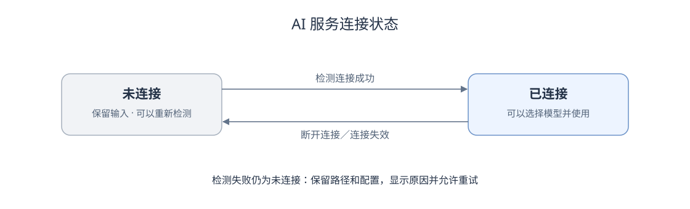

# AI 配置与 DeepSeek Harness 接入设计

## 交互和状态

AI 配置沿用现有气泡，按“服务类型 → 检测 → 模型和可选推理强度 → 保存”的顺序展开。默认隐藏安装路径。PATH 中没有 `dsh` 时，显示输入框并填入本机服务提供的默认路径，立即检测一次；未找到时保留该路径并提示填写实际位置。只保留“检测连接”按钮，填写路径后检测该位置，清空路径后重新查找命令。字段使用明确标签，检测结果显示模型数量或错误原因。保存按钮不可用时提供原因提示；检测与保存使用各自的进行状态。选项列表沿用 Radix Select，颜色由应用主题控制，包含选中、键盘焦点和滚动状态；独立 Portal 中的选项操作不会关闭 AI 配置气泡。模型选项来自 DSH 原生模型目录，按提供方分组时保留运行时给出的名称和标识。

气泡修改作为草稿，保存后才影响后续请求。机器人单独模型选择复用同一组选项。左下角“设置 → AI 配置”管理全局连接与默认模型；聊天栏入口打开“AI 选择”，与机器人页面共用服务、模型及推理等级字段。聊天气泡每次打开时以当前对话实际配置建立临时草稿；关闭气泡或取消服务切换时丢弃该草稿，只有保存并完成必要确认后才同步机器人配置。未配置时入口的模型名称留空，保留可点击的配置标记，并在入口下方和配置区域显示红字“请先在设置中配置 AI”；已配置时，入口与机器人条目按“服务名称 | 模型名称”显示实际生效值，如 `DSH | GLM 5.3`。跟随全局的机器人显示当前全局 Harness 与模型；单独选择的模型用于该机器人的后续回答；已有对话使用当前选择的服务，切换服务需确认并保留当前对话；各服务分别保存原生会话关联。两个气泡独立定位，聊天入口不展开左下角设置菜单。气泡只保存或取消 AI 字段，角色名称、指令等未保存输入保留；机器人页面的保存与取消仍作用于该机器人的完整草稿。全局配置变化时动态解析继承值，不将全局模型复制进机器人。生成状态、停止、错误重试和权限确认位于聊天栏，不改变三栏导航结构。

## 工程职责

- `apps/web/src/ai/`：本机服务客户端、配置状态、执行恢复、实时执行快照、断线恢复和消息合并。
- `apps/web/src/components/`：AI 配置气泡、机器人模型选项、聊天状态和权限确认。
- `apps/local/src/solvemate_local/`：新增 Python + FastAPI 本机连接服务，负责 Harness 子进程、配置检查、会话绑定、执行状态和事件保存。
- `apps/server/`：继续只负责官方内容，不接收个人资料与问题。
- `packages/contracts/src/`：连接、资料引用和会话执行的数据类型。
- `user/ai/`：本机服务的配置与执行记录；继续沿用当前纳入 Git 的约定，不添加忽略规则。模型凭据仍由外部 Harness 管理。

新增本机服务落实整体架构已确定的本机连接职责，独立于官方内容服务。个人记录由 012 保存到本机，浏览器仅保留缓存；官方内容数据库独立管理。启动脚本统一启动、检查和停止新增服务。

## DSH 协议适配

### DSH 适配范围与接口差异

共同对话规则见[整体架构](../../architecture/overview.md#对话规则与-harness-适配)。以 DSH 的真实会话管理为依据定义规则，再由适配器提供统一操作和事件；原生实时接口已接入执行流程，会话重命名和归档等管理功能仍按各自范围实施。

| 对象或操作     | 适配后的规则                                                                 | DSH 接口与当前差异                                                                                                                                                           |
| -------------- | ---------------------------------------------------------------------------- | ---------------------------------------------------------------------------------------------------------------------------------------------------------------------------- |
| 正式会话       | 本地对话与所属连接、原生 session 固定对应；后续请求沿用该绑定                | 原生接口按已保存编号查找与继续，保留 ACP 创建的会话；按稳定连接编号保存绑定，DSH 与 Hermes 分别适配；详见 [004 设计](../004-hermes-harness-adapter/design.md)                                           |
| 提问与执行     | 一轮执行有独立编号，状态、正文、工具和权限按该轮归属展示                     | 原生正文帧、持久化消息与权限事件转换为统一执行快照，页面不直接解释原生通知                                                                                                    |
| 切换模型       | 同一 session 使用新模型，保存各轮实际模型，不重开会话                        | 原生 `session/selectModel` 设置本会话模型和推理等级；临时禁用配置编辑器，不保存 DSH 的默认值                                                                                                       |
| 切换教师或服务 | 切换教师建立新对话；切换服务保留当前对话与各服务绑定                         | 页面统一确认与取消；首次使用服务时建立原生会话，切回时恢复该服务原编号                                                                                                       |
| 关闭与停止     | 关闭连接、结束当前执行和删除会话分别处理                                     | `session/cancel` 请求停止；确认终止后关闭该会话的 Host 释放占用，已保存记录仍保留                                                                              |
| 标题与重命名   | 目标是读取原生标题并同步用户改名；外部改名后能够重新读取，不依赖标题匹配会话 | DSH Host Session Controller 提供重命名，ACP 没有该操作；当前 SolveMate 自动标题和手动改名仅保存在本地，原生标题同步待验证                                                    |
| 列表与历史     | 原生编号用于核对归属、补充状态和按原生条目去重；本地保留离线展示记录         | ACP 可列举但不回放历史；Host API 提供历史读取和跟随。导入既有 DSH 会话的范围、两个入口同时使用的处理方式仍需设计                                                             |
| 归档与恢复     | 核对服务侧归档、恢复及运行中任务的处理结果，不能用本地隐藏冒充服务侧归档     | Host Workspace Controller 提供归档、取消归档；归档运行中会话时有拒绝或请求停止的约定。当前页面归档后隐藏提问入口，移回进行中后可续聊；原生归档同步与运行中任务的处理仍待验证 |
| 删除           | 区分本地隐藏和原生记录清除，明确作用范围及结果                               | 当前只设置本地删除标记；ACP 不提供删除，不通过直接改写 DSH 会话文件实现管理操作                                                                                              |
| 连接检测       | 查询版本与模型目录，不创建或恢复检测会话，不发送模型问题     | 使用临时 Host 查询目录后退出；连接配置与模型选项仍由公共连接服务保存                                                                       |

DSH 原生接口依据：[ACP](https://github.com/deepseek-ai/deepseek-harness/blob/master/packages/acp/acp/README.md)、[Session Controller](https://github.com/deepseek-ai/deepseek-harness/blob/master/packages/api/session-controller/README.md)、[Workspace Controller](https://github.com/deepseek-ai/deepseek-harness/blob/master/packages/api/workspace-controller/README.md)。2026-11-10 另核对本机 0.2.2-rc.1 安装包，包含会话重命名、归档和取消归档的实现；这项源码核对不代表已经验证 SolveMate 可以调用这些 Host 接口。

会话管理负责教师、资料关联、学习标签、本地保存和调用顺序；服务适配器负责创建、恢复、模型设置、提问、取消及管理操作的原生实现；协议通信负责请求、通知和连接生命周期。具体代码职责与多服务数据结构见 [004 设计](../004-hermes-harness-adapter/design.md)。

原生实时执行的实现、异常处理和专项验证见本文“DSH 原生流式实现”。重命名、归档、外部历史同步继续按各自范围设计和验收。

实施验收应覆盖：正式会话追问与重启恢复不更换原生编号；切换模型保留编号；切换教师或服务的确认与取消；重命名和归档的服务侧确认、外部变更及失败处理；断线后核实原执行而不重复提问；连接检测不创建会话；已有本地对话和绑定继续可用。后续每个 Harness 适配器复用这些验收要求；无法满足时记录具体差异并讨论规则调整，不静默替换行为。

### 与 headless 命令行调用的比较

| 内容       | ACP                                  | `dsh headless --json`                               |
| ---------- | ------------------------------------ | --------------------------------------------------- |
| 进程使用   | 一条协议连接承载多个独立会话         | 每次启动执行一个任务后退出                          |
| 追问与恢复 | 创建、恢复、关闭会话均有独立接口     | 通过 `--session-id` 继续已存在会话                  |
| 模型选择   | 返回实际模型及配置选项，可按会话设置 | 通过对应 profile 配置，帮助参数没有同等会话配置接口 |
| 取消和权限 | 提供取消通知与权限请求/应答          | 更适合终端或脚本执行；网页需要额外适配生命周期      |
| 跨平台     | 处理各系统启动入口，协议保持一致     | 同样需要处理启动入口、进程和 UTF-8 输入输出         |

DSH 正式执行采用原生 Host，ACP 保留为独立协议验证入口，执行失败时不自动回退或重发。headless 用于人工诊断，不作为用户必须选择的调用方式。

macOS 支持已注册的 `dsh`、应用包路径和包内命令。Windows 支持已注册命令和桌面安装位置，兼容空格及中文路径；桌面运行时通过其打包入口启动，避免要求用户另装 Node.js。子进程关闭按系统处理，只结束本服务创建的进程及其子进程。Mac 实际验证与 Windows 启动适配测试分别记录，未获得 Windows 实机结果前不宣称已完成该平台端到端验收。

使用已安装桌面应用附带的 `dsh`，以参数数组启动 `web --no-open`；不通过桌面界面自动操作，不连接未公开的桌面内部接口。各系统优先通过 PATH 查找 `dsh`。命令缺失时，由网页填入本机服务返回的默认安装位置并检测一次；模型配置等错误不会触发路径替换。macOS 默认为 `/Applications/DeepSeek Harness.app`。Windows 遵循 DSH 的每用户安装规则，通过 `SHGetKnownFolderPath(FOLDERID_UserProgramFiles)` 取得用户程序目录，拼接 `DeepSeek Harness`；系统接口不可用时回退到 `%LOCALAPPDATA%\Programs`，再无该环境变量时使用当前用户目录下的 `AppData\Local\Programs`。不扫描整个磁盘，不修改 PATH。只启动用户配置的程序，不接受网页提供任意命令参数或环境变量。

连接检测读取版本和模型目录，不创建会话或发送模型请求。正式新建使用 `session/create` 并立即保存返回编号；恢复使用原编号的跟随快照与模型选择，不通过创建接口替代。问题沿用公共 Prompt 模板和目标会话的引用接收记录；原生正文、工具与权限由 DSH 适配器转换为公共事件。停止与进程退出分别处理，详见下文实现说明。

### 桌面自定义模型

配置目录按本机服务继承的 `DSH_HOME` 解析，未设置时使用当前用户的 `.dsh`。路径与安装位置无关；服务无法获知其他进程单独设置的环境变量。

读取 `profiles/desktop/cordis.patch.yml` 时仅提取 `@deepseek-ai/dsh-llm-pi-ai` 的提供方配置，不复制桌面插件。通过官方 `dsh acp --dump-config` 获取 ACP 的有效配置，保留该插件的现有配置与提供方，再补充桌面提供方；同名提供方以 ACP 有效配置为准。

将结果写入系统临时目录中的当前用户私有文件，通过官方 `--patch` 参数加载。文件在进程关闭或启动失败后删除，不写入项目、连接数据库和日志；凭据引用仍交给 Harness 解析，不读取它的凭据库。桌面配置不存在时使用 ACP 自身选项；配置损坏、不可读、包含多个同名插件或动态提供方表达式时明确报错。当前未适配其他模型插件与任意 profile。

自动模式保存空程序路径，每次运行重新查找命令；手动模式保存用户指定位置。会话绑定保存建立时的实际程序路径、工作目录和 DSH 配置目录。程序或配置目录变化后，适配器仍使用原编号和保存的工作目录尝试恢复；能否继续取决于 DSH 的恢复结果。DSH 要求恢复时的工作目录与原生记录匹配，此项原生限制单独报错，不与程序位置变化混同。

## 回复与等待状态

学生问题靠右、教师回复靠左，采用颜色不同的圆角气泡。发送后立即显示教师气泡，在回复位置展示连接、等待、接收正文、工具、权限确认和停止状态，以及本轮用时。收到增量内容即更新同一条回复；停止、错误和权限操作均跟随该气泡。用户向上查看历史时不强制滚回底部。

DSH 原生跟随接口提供生成中的正文增量，本机服务将实际内容通过 SSE 发送到网页；最终正文按原生持久化消息校正。思考只显示状态，模型尚未输出正文时保留等待或思考提示。实现与验证见下文“DSH 原生流式实现”。

## 会话与执行记录

SolveMate 的会话编号不等于外部 sessionId。绑定记录包含外部编号、实际程序路径、工作目录和 DSH 配置目录。每轮保存独立编号、用户消息、资料引用、教师快照、模型、回复与状态。

本机服务使用 SQLite 原子保存配置、绑定和执行结果。客户端的请求编号用于去重，重复请求不能再次触发同一轮模型调用。运行中请求由本机服务持有，网页通过带客户端请求头的 SSE 读取执行快照：先发送当前结果，再推送状态和正文变更，每 5 秒发送心跳。心跳仅表示本机连接可用，不代表模型已生成文字。连接中断后先按原编号查询，重连间隔最多退避至 8 秒；旧服务不支持 SSE 时回退到查询。刷新或短暂断开不会自动重发模型请求。本机服务重新启动时把未结束执行标为中断，再恢复外部会话，避免显示永久生成中。实时连接 12 秒未收到数据时中断并重新检查；用户收到的部分回复继续保留。

网页展示消息保存在 `user/app.sqlite3`，IndexedDB 仅作缓存。本机按执行分别保存记录，网页仍按应用快照提交，长会话分页和增量存储另行设计。恢复读取本机结果时按消息与执行编号合并，不重复追加，也不覆盖用户在其他会话中的修改。

## 本机访问

本机服务默认只监听 `127.0.0.1:8765`，网页通过同源 `/local-api` 代理访问。写请求必须具有允许的本机网页 Origin、JSON 内容类型与客户端请求头；Host 同样校验，防止其他网站经浏览器执行本机操作。代理端口由启动配置明确传入，不开放任意来源。

浏览器中不保存模型密钥。Harness 的配置与凭据由其自身解析。检测与调用不通过官方内容服务。服务退出只结束自己创建的 Harness 进程，不终止用户已经打开的桌面应用。

## 验证记录

2026-11-10，macOS 上使用已安装的 DeepSeek Harness **0.2.2-rc.1**，使用安装包附带的 `dsh`。测试分别覆盖 PATH 发现和手动应用路径；沿用 Harness 自身的账号与提供方配置，没有读取其凭据库。

### 协议与模型

- 协商结果为 ACP v1，声明会话 `close`、`list`、`resume`，未声明历史回放；恢复采用 `session/resume`。
- 首次探测时 ACP 自身返回 3 个模型，复用桌面提供方后返回 10 个，包含 EABot Gateway 的 7 个自定义模型。切换至 GLM 5.3 后运行时返回 9 个选项，界面按该结果显示，7 个自定义模型均在列表中。值是 Harness 返回的原始字符串，例如 `["eabot","glm-5.3"]`，不能根据显示名生成。
- 运行时返回 `off`、`low`、`high`、`max` 推理选项；网页按所选模型重新检测，不提供未声明的温度参数。
- 本机声明图片、音频和嵌入式上下文输入均不可用；本次传递实际课程文字。没有验证 PDF/PPT 原件、桌面插件或内部桌面会话的复用。

### 实际调用与网页验证

| 项目               | 实际结果                                                                                                                                                                    |
| ------------------ | --------------------------------------------------------------------------------------------------------------------------------------------------------------------------- |
| 自动发现与手动路径 | PATH 无命令时填入 macOS 默认应用路径并自动连接；实际返回 10 个模型。默认路径也缺失时的提示、手动路径保留及条件变化后的重试由自动测试验证                                    |
| 自定义提供方调用   | GLM 5.3 实际回答 C 整数除法与浮点除法，服务重启后恢复同一外部会话并记得练习代号；临时配置文件已清理                                                                         |
| 首次提问与追问     | C 整数除法题得到 2.0；依赖前文询问转换为 `(double)a / 2` 后得到 2.5                                                                                                         |
| ACP 进程重启       | 关闭并重新启动自己创建的 ACP 进程，恢复同一外部编号，回答能够引用此前练习代号                                                                                               |
| 网页配置与模型     | 检测、全局模型保存与取消、机器人独立模型均通过；全局 Flash 下用机器人单独 Pro 实际收到回复                                                                                  |
| 阅读内容与普通会话 | 阅读请求含当前 C 语言章节正文；普通会话不携带后台题目；真实回复能够概括引用内容                                                                                             |
| 网页刷新与服务重启 | 保存并重新打开后能继续追问；停止全部服务后重新启动，原会话仍能使用此前信息，外部编号未改变                                                                                  |
| 停止与错误         | 真实生成可以停止；错误路径检测保留草稿，可取消恢复。模型失败与重新提问、权限按钮另用可控响应检查网页交互                                                                    |
| 脱离官方内容服务   | 屏蔽官方内容接口后，本机 AI 仍可调用；不等于模型服务断网可用                                                                                                                |
| 外观与布局         | 1600×900 桌面截图；390×844 窄屏 AI 配置处于视口内；夜间外观检查通过，未发现浏览器脚本错误                                                                                   |
| 启动与停止         | `npm start` 启动三个服务；停止后网页、两个 Python 服务及自己创建的 ACP 进程均已退出。停止检测先接收子进程退出事件，再检查进程组，已复现的 macOS 退出间隙 EPERM 异常回归通过 |

工具权限的允许、拒绝、失效选项和执行归属通过本机服务测试验证；网页权限确认与失败重试使用测试响应验证。没有将测试回复写入正式示例或声称它们来自模型。真实模型测试只使用合成的学习问题。

### DSH 桌面会话列表

2026-11-10，在 macOS 的 DSH 0.2.2-rc.1 中核对：SolveMate 通过独立 ACP 进程创建的会话保存在同一个 `~/.dsh/sessions` 中。已打开的桌面列表没有自动显示这些新会话；完全退出并重新打开 DSH 后，平台对话和真实模型测试会话出现在“未分组”。打开其中 20:55 发起的 C 语言整数除法测试，教师要求、资料引用和回复内容与 SolveMate 记录一致。该次实测说明会话已经保存，但桌面列表不会及时反映其他进程创建的会话，不能将桌面即时可见作为 ACP 调用成功的条件。

连接检测保存并复用专用会话，检测结束时调用 `session/close` 释放；关闭不会删除已保存的会话，因此首次检测仍可能留下“未命名”空会话。实际提问以学生原问题开头，随后附上教师要求、首次绑定所需的本地历史和本轮资料，避免固定教师指令前缀被用于生成标题。已有原生标题保持原值，原生重命名与管理同步仍需接口支持。检测会话占用和两端交替使用的规则见[会话设计](../../architecture/conversation-metadata.md#9-两端会话定位管理与内容核对)。

### 自动测试与平台范围

- 网页 82 项测试，覆盖原有阅读、存储、会话及执行合并、请求错误、引用快照、全局模型继承、机器人覆盖、失效模型和 AI 字段保存范围；启动与构建补丁共 11 项测试。
- 本机服务 42 项测试，覆盖命令发现、macOS 默认路径、Windows 中文及重定向目录、系统目录接口失败回退、安装路径回退、配置目录解析、提供方合并、配置错误、临时文件权限与清理，以及去重、并发、配置失败保留、恢复失败、权限、取消、来源限制及异常中断。真实 Python 子进程测试检查 UTF-8 通信、超时、断开和关闭。macOS 常规执行跳过真实模型调用和 Windows 原生目录接口测试；Windows 的原生目录接口测试已加入双平台任务，尚未在实机运行。
- 官方内容服务 24 项回归测试通过；另显式运行真实 ACP 提问、追问与进程重启恢复测试，1 项通过。常规测试默认跳过该真实模型测试。
- TypeScript、ESLint、Prettier、Ruff、依赖一致性和生产构建按项目命令验证。
- Windows 启动适配覆盖含中文和空格的安装路径、官方 `.cmd` 到同包运行时的转换及参数数组调用。GitHub Actions 配置 macOS / Windows 检查、测试和构建，尚未在远程执行。

当前没有 Windows 测试电脑。Windows 的安装检测、真实账号调用、会话恢复和进程关闭仍需实机验收，不能以 macOS 上的适配测试代替。

## 参考

- [DeepSeek Harness ACP](https://github.com/deepseek-ai/deepseek-harness/blob/master/packages/acp/acp/README.md)
- [CLI 配置加载参数](https://github.com/deepseek-ai/deepseek-harness/blob/master/apps/cli/reference/README.md#profile-boot)
- [模型提供方配置](https://github.com/deepseek-ai/deepseek-harness/blob/master/packages/llm/llm-pi-ai/README.md)
- [配置主目录解析](https://github.com/deepseek-ai/deepseek-harness/blob/master/packages/util/home-paths/src/index.ts)
- [桌面版命令与运行时](https://github.com/deepseek-ai/deepseek-harness/blob/master/apps/desktop/README.md)
- [ACP 会话建立与恢复](https://agentclientprotocol.com/protocol/session-setup)
- [ACP 提问与事件](https://agentclientprotocol.com/protocol/prompt-turn)

默认安装路径依据：

- [DSH Windows 打包配置](https://github.com/deepseek-ai/deepseek-harness/blob/master/apps/desktop/scripts/electron-builder-config.mjs)与[安装脚本](https://github.com/deepseek-ai/deepseek-harness/blob/master/apps/desktop/scripts/installer.nsh)：每用户 NSIS 安装，安装目录沿用 electron-builder 规则。
- [Windows 用户程序目录](https://learn.microsoft.com/en-us/windows/win32/shell/knownfolderid)：`FOLDERID_UserProgramFiles` 默认为 `%LOCALAPPDATA%\Programs`，可由系统重定向。

机器人 AI 配置一致性验证覆盖：无全局配置提示、右上角与设置菜单独立显示、全局 Harness 与模型显示、单独模型保存、跨入口草稿、取消恢复、保留角色草稿、恢复跟随全局、全局模型变更及刷新恢复。测试使用独立本机服务与浏览器站点。

回复显示验证：SSE 的分段中文、帧边界、断线、错误执行编号、停止与监听清理由自动测试覆盖；模拟回复用于检查分段呈现、断线重连不重复提交、停止保留部分内容及错误气泡。真实 DSH 用于验证等待状态、模型回复和实际返回时序，模拟内容不写入正式示例。

2026-11-11：对话 AI 配置的浏览器回归覆盖取消服务切换、按 Esc 取消、关闭未保存的选择、确认切换后新旧对话各自显示原有配置，以及同一服务内保存模型后重新打开。取消后气泡显示当前实际服务，不残留未确认的选择；保存 AI 配置后，机器人页面未保存的角色输入仍保留。独立测试站点使用已保存的两项服务配置快照，未发起模型调用，未修改正在使用的站点记录。92 项网页测试、11 项脚本测试、TypeScript、ESLint、格式检查和生产构建通过。

### 连接、模型与进程状态机

本节为当前连接管理规则；自动检查与交互验证结果见[配置一致性测试](test-plan.md)。

AI 服务下拉框来自适配器的支持目录，例如 DSH、Hermes、Codex。每个支持的服务只有“已连接”和“未连接”两个状态。路径、模型目录、错误原因和历史会话是相关数据，不增加“已配置”“已启用”“已停用”或“待恢复”等状态。



可编辑源文件：[drawio](../../architecture/ai-connection-state.drawio)。

| 当前状态 | 操作或结果   | 后续状态与行为                                                             |
| -------- | ------------ | -------------------------------------------------------------------------- |
| 未连接   | 检测连接成功 | 进入已连接，显示实际返回的模型列表                                         |
| 未连接   | 检测连接失败 | 保持未连接，显示原因与重试入口，保留安装路径等输入                         |
| 已连接   | 删除配置     | 结束本应用在该服务上的回复和检测，释放会话与进程并删除连接参数，回到未连接 |
| 已连接   | 服务连接失效 | 回到未连接，保留配置、旧模型列表、草稿和历史记录，提供重新连接操作         |

“检测连接”负责判断是否能进入已连接状态。保存了安装路径或模型列表不等于已连接。连接状态由本机服务统一提供，页面不另存开关，也不因看到旧模型目录就判断连接成功。检测中、删除中只作为按钮的临时进度显示。

连接配置保留用户填写的安装路径，留空表示自动查找；检测结果单独记录实际解析出的程序路径。检测和保存采用相同规则，保存模型不改写安装路径。检测、保存成功后，表单与编辑基线同步采用服务返回的配置；设置全局默认模型时保留尚未保存的推理等级选择。

配置表单直接读取共享连接记录，仅保存尚未提交的字段改动。保存成功后清除这些改动，路径、模型和推理等级同时读取共享结果；背景刷新不再与一整份旧表单互相比较。共享结果同时校验偏好版本与各连接版本，较早的保存应答或刷新应答不能恢复已删除的连接，也不能覆盖新路径和模型。

全局配置、机器人和对话栏共用本机 AI 配置的读取结果。页面、当前对话切换及打开 AI 配置时重新读取；保存或删除成功后立即更新共享结果，迟到的读取不能覆盖新配置。内部选择框只列出已连接的服务及其当前模型，失效的选项不作为当前选择展示，并说明重新配置的原因。历史对话和机器人中保存的服务、模型引用仍保留，重新连接同一服务后重新判断是否可用；已有对话不因全局默认模型改变而自动更换模型。

#### 未连接时如何重新连接

未连接页面保留已保存的路径及配置，提供“检测连接”。未手动指定位置时先查找程序；找不到时显示安装路径输入框，填入当前系统的默认位置，用户可以修改后再次检测。已有手动路径不被覆盖。适配器负责通过 ACP 等接口连接，用户无需另选协议或填写命令参数。

重连前清理本应用残留的进程和会话句柄；清理失败保留重试入口，不并行新建进程争抢会话。成功后使用同一服务编号和原会话绑定，不自动重发失败问题，不新建替代对话。失败仍为未连接，保留输入供继续修改和重试。

某一条会话被占用、丢失或回复失败，不足以认定整个服务连接失效，只处理具体会话。占用来源需要核实，不笼统要求退出整个 DSH，不结束用户独立启动的进程。

#### 删除配置与默认模型

- 界面不提供单独的“断开连接”按钮。删除配置和服务退出时，统一释放本应用在该服务上持有的会话、进程及子进程；清理失败时保留配置并提示重试。
- “删除配置”先断开，再删除保存的连接参数。服务仍留在支持目录中，显示未连接；历史对话和第三方会话保留。
- “设为默认”与“取消修改”“保存配置”并列，明确保存 `{ connectionId, modelId }`，只能选择已连接服务实际返回的模型。它不改变连接状态，也不创建对话。
- 默认模型所属服务断开或连接失效，或配置被删除时，清空全局默认，显示“当前未设置全局默认模型”。重连不自动恢复默认，不自动选择其他模型。
- 已有教师和对话保留原服务、模型及第三方会话编号；服务未连接时给出重新连接入口，不静默切换服务。

同一服务的操作集中由连接管理服务处理。断开、删除与默认清空使用统一规则；迟到的检测或回复不能把已断开的服务重新标为已连接，不能覆盖新配置。失败保留旧数据，页面与后端按同一服务编号读取结果。

实施时验证检测成功与失败、断开及残留进程处理、重连和路径修正、默认模型清空、旧模型列表保留、多窗口及迟到结果。真实会话占用另行核实，不将模拟验证当作 DSH 实测结论。

2026-11-12：263 项网页测试、19 项脚本测试、52 项会话恢复和适配器专项测试通过；类型、格式、Ruff 检查及构建通过。独立网页环境验证四个按钮等宽等高、连接启停、全局默认、取消删除、占用提示仅显示一次，以及解除模拟占用后的重新检测；日间与夜间均已核对。未结束用户的 DSH 进程，未调用真实模型或 Codex。

## 配置读取、编辑与保存

### 数据归属与显示

| 对象           | 保存位置与用途                                                                 | 页面如何使用                                                   |
| -------------- | ------------------------------------------------------------------------------ | -------------------------------------------------------------- |
| 支持的服务目录 | 适配器提供 DSH、Hermes、Codex 等服务及查找规则                                 | 全局 AI 配置列出所有支持的服务                                 |
| 连接记录       | 本机数据库按稳定连接编号保存路径、模型、推理等级、检测目录、连接状态和连接版本 | 所有页面读取同一份共享结果，不另存已保存配置                   |
| 全局默认模型   | 本机偏好保存连接编号、模型编号和偏好版本                                       | 未设置独立配置的机器人使用它；不覆盖已有对话的明确选择         |
| 表单改动       | 当前表单只保留用户尚未提交的字段                                               | 与最新连接记录组合显示；取消时清除改动，保存失败时保留改动     |
| 对话关联       | 对话保存服务、模型与第三方会话编号                                             | 连接被删除后保留关联；重连时由适配器恢复原会话，不新建替代会话 |

模型编号仅用于查找和提交，例如 DSH 的提供方与模型组合编号；页面从模型目录读取名称。连接或模型不可用时清空当前可用模型显示，并提供原因，不把内部编号当作名称。

### 操作规则

1. 进入页面、切换对话或打开配置时读取本机记录；保存、检测或删除成功后发布服务返回的共享结果。读取失败保留已有数据和未保存输入，并提供重新读取入口。
2. 表单未修改的字段始终来自共享记录。只修改模型或推理等级，不会产生路径改动；真正修改路径后才要求重新检测。配置中的路径保留用户输入，检测结果另存解析出的实际程序路径。
3. 保存同时提交完整配置、连接版本和偏好版本。后端先检查版本，再校验模型与推理等级；路径未变且连接有效时复用已获取的目录，不再次创建检测会话。
4. 保存成功后清除本次改动，所有字段采用同一份共享记录。设为默认只提交默认模型选择，保留表单中尚未保存的推理等级；失败时不清空输入，也不显示保存成功。
5. 共享记录同时比较偏好版本及各连接版本，不接受版本倒退。删除会推进偏好版本；重连沿用稳定编号并推进连接版本，因此较早的读取和保存应答不能撤销删除或重连结果。较早的读取出错，也不能覆盖后续读取或保存的成功状态。
6. 未保存输入遇到另一窗口修改时，保存使用版本检查拒绝覆盖；用户核对最新内容后才能再次提交。页面刷新和配置刷新均不触发模型提问。

### 实施与验证范围

实现保持在连接服务、共享 AI 状态、配置表单和已有配置解析函数中，不增加连接状态、第二份模型目录或另一套机器人连接列表。旧连接状态字段和旧默认连接编号在读取时兼容，历史会话编号和个人记录保持原值。

测试设计与结果见[配置一致性测试](test-plan.md)。本次提交仅包含 AI 配置、连接管理、相关显示与验证，不包含阅读器、官方资料格式、笔记样式和其他独立改动。

## DSH 实时接口验证

2026-11-12，使用 macOS 上已安装的 DSH **0.2.2-rc.1**，在独立 Harness 主目录和工作目录中验证。由 Harness 自身解析现有模型凭据；凭据文件的验证前后校验值一致。只创建并复用一个已登记的测试会话，未调用用户正式会话或 Codex，未替换应用中的 ACP 适配器。

### 接口与实际结果

本机版本的 ACP 和标准 SDK 都只转发已提交的会话消息。原生 Web 会话接口通过 `session/follow` 的 `assistantStream: true` 提供生成中的文字增量；请求通过经过认证的 HTTP RPC 提交，订阅使用 `/api/remote.mux` WebSocket。验证进程通过 `dsh web --no-open` 启动，不依赖桌面窗口。

| 验证项         | 实际结果                                                                                                                                                                                                 |
| -------------- | -------------------------------------------------------------------------------------------------------------------------------------------------------------------------------------------------------- |
| 真实正文增量   | GLM 5.3 在约 2.8 秒返回首段正文，约 9.6 秒完成；生成过程中持续收到 `text-delta`，重连后仍收到 221 个正文增量，不是收到整段答案后播放动画                                                                 |
| ACP 会话接续   | ACP 创建并完成第一轮，关闭后由原生接口读取并继续同一原生编号；回复正确引用此前的合成练习代号                                                                                                             |
| 生成中重连     | 断开 WebSocket 后重新订阅，返回同一会话的历史、当前生成编号、已生成内容和下一个增量序号；无需再次提交问题。另一轮约 3.2 秒返回首段、7.9 秒完成，重连时已生成的文字加上后续增量，与最终持久化正文逐字一致 |
| Host 重启恢复  | 停止自己创建的 Host 并重新启动后，继续同一会话，正确回答此前的练习代号与讨论内容                                                                                                                         |
| 返回 ACP       | 原生 Host 退出后，现有 ACP 能恢复同一编号并依据原上下文回答                                                                                                                                              |
| 停止生成       | 正文输出后停止，保留部分正文，原生结束原因为用户中止；等待正文期间停止，约 3 毫秒收到终止事件。时间仅为本机该次观测                                                                                      |
| 模型与目录     | 原生目录返回 9 个当前可用模型，包含 7 个自定义模型；在同一会话选择 Qwen 3.8 Max 后再选回 GLM 5.3，原生编号不变。未调用 Qwen 模型生成回复                                                                 |
| 重复请求       | 使用同一个 `requestId` 再次提交已接受的问题，返回接受结果，持久化事件游标不变，没有再次排队                                                                                                              |
| 会话占用与丢失 | 原生 Host 持有写句柄时，另一个 ACP 进程恢复该编号被拒绝；不存在的编号返回 `session/not-found`，未创建替代会话                                                                                            |
| 权限拒绝       | 测试操作触发 `approval/request`，通过 `$events/result` 返回拒绝；原生日志包含询问与拒绝记录，目标测试文件不存在。没有把沙箱直接拒绝误记为用户权限确认                                                    |

长回答测试在约 90 秒后才出现正文，原生持久化记录显示其中约 88 秒处于模型思考阶段。流式接口能及时传递已经生成的文字，不能保证模型立即开始输出正文。界面应分别显示等待、思考与正文生成状态，不展示原始思考内容，不用心跳或累计时间代替实际进度。

### 接入前需要处理的差异

- **会话身份不变。** 原生会话编号、原始工作目录和持久化库仍是恢复依据。沿用现有对话、执行编号和请求去重规则；缺失或占用时明确报错，不新建替代会话。同一原生会话不能同时交给 ACP 与原生 Host 写入。本机实现中 `session/create` 会在指定编号已用于非空会话时创建另一条会话，不能将它当作恢复接口；恢复应通过已存在编号的解析与接续完成。
- **增量与持久化消息分别处理。** 实时文字带生成编号和序号，重连先接收当前已生成内容，再接收后续增量；最终提交的消息应确认或替换对应临时正文，不能再次追加。新的生成尝试、工具步骤和失败重试需要按原生事件区分，不能把所有文字直接拼成一条回复。
- **选择模型会保存默认值。** 原生 `session/selectModel` 同时记录会话选择并保存当前 DSH profile 的默认模型。正式接入需隔离默认模型写入，保留原有会话库与模型提供方。2026-11-14 复核已验证：通过本次启动补丁禁用配置编辑器即可阻止默认值写入，无须另建 profile；具体结果与 Host 管理方案见下方。模型和推理选项依据目录校验；本机 GLM 5.3 对显式传入 `off` 返回不支持，不能强制套用该值。旧配置包含不支持的推理选项时，应提示调整，不静默改写模型或参数。
- **进程与认证由适配器管理。** 原生接口需要本机 Host、启动令牌交换和认证 Cookie；这些信息留在本机服务中，不交给网页。当前公开会话接口没有与 ACP `session/close` 对等的单会话释放方法，停止回复不等于释放写句柄，需要明确自己创建的 Host 的使用和退出时机。连接检测可读取模型目录，不必为获取选项创建空会话。
- **公共会话规则继续共用。** 原生帧转换为现有适配器事件，由现有执行保存与 SSE 向网页发送。对话名称、标签、归档、资料引用和教师配置继续由现有模块管理，不为流式接口增加另一套对话记录。

本次未将原生接口接入正式页面。权限允许一次、等待权限期间断线、提供方失败重试和 Windows 实机行为尚未验收，不能视为已完成生产接入；正式开发时还需对这些路径补充自动测试和相应实测。

参考：[Session Controller](https://github.com/deepseek-ai/deepseek-harness/blob/master/packages/api/session-controller/README.md)、[Gateway](https://github.com/deepseek-ai/deepseek-harness/blob/master/packages/api/gateway/README.md)、[SDK 协议](https://github.com/deepseek-ai/deepseek-harness/blob/master/packages/sdk/protocol/README.md)。具体字段同时核对了本机安装包的实现和生成的接口定义，未把主分支文档当成本机版本的验收结果。

### 模型配置与 Host 生命周期复核（2026-11-14）

本机 DSH 已更新为 **0.2.2-rc.2**。本次使用独立 Harness 主目录与工作目录，复用原先登记的会话，并登记一条用于并发验证的专用会话。三次真实模型请求均使用用户已配置的 GLM 5.3；Qwen 3.8 Max 只用于模型选择检查，未请求生成。未操作用户正式会话，未调用 Codex，正式应用仍使用 ACP。

#### 模型配置：仅禁用本次进程的配置编辑器

`session/selectModel` 先记录会话选择，再调用默认模型服务保存 profile 设置。官方默认模型服务在没有配置编辑器时跳过保存；会话自身的模型选择仍然生效。可在现有启动补丁中增加：

```json
{ "id": "config-editor", "disabled": true }
```

补丁只用于 SolveMate 启动的 Host，不修改用户 profile、不复制凭据，也不更换正式连接的 `DSH_HOME` 或会话库。模型提供方继续按现有方式加载，由 Harness 解析凭据。SolveMate 的全局默认模型仍保存于自身配置，不写入 DSH 的默认设置。

实测在同一原生会话中选择 Qwen 3.8 Max，再切回 GLM 5.3，接口正常返回所选模型；模型目录的默认选择保持不变，测试 profile 的文件校验值在选择前后及验证结束时一致。用户原有 profile 和凭据文件的校验值在整个验证前后也一致。禁用配置编辑器后，原会话仍能使用已保存的上下文回答，后续重开也能继续。

此方案使用 DSH 的插件补丁与默认模型服务原有行为，无须新增 profile 或安装自定义插件。相关能力不可用时应在提交问题前说明版本不支持，不能忽略补丁失败后继续运行。

#### Host：按正在处理的会话启动与退出

本机公开会话控制接口仍没有与 ACP `session/close` 等价的单会话释放方法。以下实测分别核对了原生编号、占用结果及回复内容：

| 操作                                     | 实际结果                                                                            |
| ---------------------------------------- | ----------------------------------------------------------------------------------- |
| 关闭 WebSocket 订阅                      | Host 继续持有会话，ACP 恢复同编号仍被拒绝                                           |
| 一轮回复正常结束                         | 会话仍被 Host 占用，不会因回复结束自动释放                                          |
| 停止生成                                 | 收到用户中止结果并保存部分正文；会话仍被 Host 占用                                  |
| 退出持有该会话的 Host                    | ACP 能恢复同编号；重开 Host 后能依据刚刚保存的上下文继续回答                        |
| 两个 Host 分别处理不同会话，退出其中一个 | 该会话可由 ACP 恢复；另一个 Host 仍持有自己的会话，继续返回正文增量并正常接受停止   |
| 停止后退出并重新读取                     | 部分正文逐字一致，用户中止原因仍保留                                                |
| 强制结束本次创建的空闲 Host              | 写占用释放，原会话可由 ACP 恢复，也能再次由原生接口加载和选择模型；已完成的历史仍在 |

三次主验证 Host 的就绪耗时约为 0.50–0.52 秒，正常退出约为 48–51 毫秒，仅代表本机此次观测。验证结束后核对本次登记的 Host 进程均已退出；未结束用户桌面进程。强制退出只验证了空闲 Host，不能据此声称生成中强制退出不会丢失尚未持久化的增量。

正式接入拟采用以下规则：

1. 收到提问后，由 DSH 适配器为对应原生会话启动 Host；同一原生会话只允许一个执行者。沿用已有对话绑定、原工作目录与会话库，不以创建接口替代恢复。
2. 生成、等待权限或订阅重连期间保留 Host。切换页面、网页刷新或仅断开订阅，不结束生成，也不另发问题。
3. 正常结束后，确认原生终止结果和持久化正文，保存 SolveMate 执行结果，再退出对应 Host；下轮重新启动并恢复原编号。
4. 停止时先发送原生取消，等待终止结果并核对已保存正文，再退出 Host。取消请求被接受不能单独当作停止完成。停止超时则限时清理自己创建的进程，保留已知结果并说明中断，不能将其显示为正常完成。
5. 不同会话使用不同 Host，关闭一个不影响另一个。只管理自己启动的进程，不删除锁文件、不结束用户桌面进程；断开连接和应用关闭复用同一清理流程。
6. Host 退出不删除 AI 配置或模型目录，不要求用户每轮重新检测连接。进程、认证和占用检查留在 DSH 适配器内，共用会话管理和网页不维护第二套状态。

上述模型隔离与 Host 释放方式用于正式适配器，实施与专项验证见下节；Windows 实机仍待环境可用后验收。

参考：[默认模型服务](https://github.com/deepseek-ai/deepseek-harness/blob/master/packages/core/agent-default-model/README.md)、[Profile 与启动补丁](https://github.com/deepseek-ai/deepseek-harness/blob/master/packages/boot/app-boot/README.md)、[Session Controller](https://github.com/deepseek-ai/deepseek-harness/blob/master/packages/api/session-controller/README.md)。补丁行为与会话占用同时核对了本机 rc.2 安装包，实测结果不以主分支文档替代。

## DSH 原生流式实现

### 职责与元数据

- `dsh_host.py` 统一负责临时补丁、回环地址校验、令牌换取 Cookie、HTTP RPC、WebSocket 和进程树清理；模型目录查询与正式执行共用。补丁禁用本次进程的配置编辑器、计划任务、自动标题生成和热重载，不修改用户 profile。
- `dsh_process.py` 按原生会话编号管理独立 Host、模型与推理选择、稳定请求编号、权限决定和有限重连。HTTP 成功响应允许没有返回值，不能把已生效的授权误判为失败。
- `dsh_stream.py` 按持久化序号、生成编号和增量序号合并正文。缺段时重新打开快照并补齐本轮历史；持久化正文替换对应临时正文，工具步骤分开合并，失败尝试与重试不会重复追加。思考正文不离开适配器，相同思考状态不反复推送。
- 公共会话服务继续负责绑定、机器人、Prompt、引用接收记录、执行保存与网页 SSE。执行编号同时作为原生 `requestId`；原生接受请求后记录已接收，结果不明时不重复提交。临时正文先保存在本地，原生确认正文后再记录对应回复的接收情况，避免将异常退出前的增量误记为完整持久化消息。

共享协议枚举增加 `dsh-native`。已有 ACP 绑定恢复同一编号后只更新绑定的协议，历史执行保留原值；不新增连接、另建对话或丢弃其他服务的绑定。公共适配器增加执行结束清理方法；DSH 释放本轮 Host 并从已加载集合移除，其他适配器保持已有进程管理方式。

### 断线、停止与恢复

普通订阅断线最多重连三次，重新接收同一会话快照，再继续后续增量；不重发问题。网页断线不结束 Host。原生撤销权限请求时同步撤销本地等待；等待决定期间断线或决定送达失败时，将本轮记为中断，清除确认框并退出本次 Host，不自动授权、不重复提交决定。

原生正常结束或确认用户中止后，保存正文与终止状态，释放对应 Host。停止请求未能确认时限时清理自己启动的进程，显示中断并保留部分正文。Host 意外退出只中断对应执行，保留绑定和连接配置；下轮按原编号恢复。找不到会话继续使用已有的用户确认流程。

进程清理复用 macOS/Windows 底层工具；失败保留进程引用供重试，不把资源清理失败显示为连接已成功删除。不会删除原生锁文件或结束用户桌面进程。

### 专项验证（2026-11-14）

macOS 使用 DSH 0.2.2-rc.2、独立 SolveMate 数据目录及已登记的原生测试会话：

- 公共执行与 SSE 在结束前收到多段真实正文，结束后没有重复追加；已有 ACP 编号继续使用，协议记录为 `dsh-native`。
- 本机服务重开后继续同一会话，未补发本地历史，回复正确使用本轮保存的代号。
- 正文输出后停止，保留部分回复并退出 Host；生成中强制退出自己的 Host 后，本轮记为中断，原绑定和连接仍在，下一次提问能够继续原上下文。
- 真实一次性授权成功写入指定测试文件；另一轮在等待授权时关闭 WebSocket，本轮中断，未写入目标文件，本地确认请求清除。
- 用户原有 profile 和凭据文件校验值保持不变。测试请求的工具参数校验拒绝未被计作权限通过；成功授权的空返回值有专门的解析回归检查。

提交前整套检查通过：网页 412 项、脚本 19 项、本机服务 327 项和官方内容服务 25 项；两项真实模型测试未启用。针对本次改动的 173 项后端检查和 45 项网页合同、API 与迁移检查通过；TypeScript、ESLint、共享 Schema 同步、Ruff 和依赖一致性检查通过。自动检查覆盖增量重连与去重、失败尝试替换、正文保留、权限允许与拒绝、原生撤销与断线撤销、Host 异常退出、停止与停止失败、旧绑定恢复、逐轮清理、清理失败重试，以及既有会话管理和 macOS/Windows 进程工具。Windows 未进行真实 Harness 调用；未调用真实 Codex。

### 模型选择与连接检测分开

DSH、Hermes、Codex 使用同一套前端连接与模型控件。模型目录直接读取本机连接记录，不再由配置气泡保存另一份检测结果。更换模型只修改表单选择；保存已连接且程序配置未变的选项时按已有目录校验，不重新加载检测会话。推理等级只使用所属模型已返回的选项，不能把另一模型的等级当作有效选项。全局默认引用明确的模型，设置后更新该服务保存的模型选择；独立教师与会话的原选择不变。

专用检测记录沿用原生编号；用户主动删除配置后，以删除修订号区分新的检测记录，避免重连继续被旧配置的检测会话占用。普通重试不改变此编号；原生正式会话和旧记录不因重新检测而删除。

### DSH 连接检测读取模型目录

DSH 检测读取程序版本及本机 Host 的 `session/modelCatalog`，不再创建或恢复专用检测会话。目录接口不依赖会话，旧检测记录仍保留但不参与 DSH 检测，避免被桌面端持有的空会话阻止重连。正式对话通过原生 Host 按原编号恢复，正文采用实时增量。

模型目录由 DSH 自身读取配置与凭据，返回完整模型及各自推理选项，统一转换成共享 `ModelOption`；前端和保存校验按所选模型读取推理选项，不按服务名称判断。旧适配器没有模型级选项时，仅保留其已返回的当前模型选项，不编造其他模型的支持等级。

目录查询启动的临时 Host 只监听本机随机端口，不打开浏览器、不打开对话，并禁用本次进程的计划任务、标题生成和热重载；认证令牌、Cookie 与临时配置不交给前端或日志，结束、失败或取消时关闭自己启动的进程。程序查找及 Windows/macOS 启动仍使用现有底层工具。本轮只完成源码调整和构建，未运行真实连接检测或模型调用。

#### DSH 模型目录启动参数

`--patch` 位于 `--no-open`、`--host`、`--port` 等 Web 参数之前。DSH 在遇到 Web 参数后会将余下参数交给 Web 解析器；后置的 `--patch` 会被当作 Web 参数，导致 `unknown option '--patch'` 并退出。目录检测保留有界的启动诊断，只将已识别的参数错误、端口占用或运行文件缺失转换为界面提示，不把原始输出、配置或启动令牌显示给用户。

## 配置操作与共用气泡

全局配置每次打开按支持目录的第一项初始化，当前目录为 DSH、Hermes、Codex；已保存连接及内部选项按同一目录排列。连接的数据库顺序和全局默认模型均不决定管理气泡的初始服务。服务扩展只维护支持目录，机器人与对话继续显示自己的实际选择。

保存与取消按钮以当前字段和已保存记录是否不同为依据：无改动、保存成功、取消或改回原值时禁用；保存失败保留改动，满足连接及字段条件后可以重试。设置默认模型仅提交对应字段，剩余未保存改动仍可提交。检测按钮统一为“检测连接”，检测期间保留秒数。

所有有名称标题的气泡共用 `PopoverPanel`：同一组件维护外框、图标标题、正文间距、关闭入口和箭头，同一份样式维护字体、圆角、颜色及内边距。业务传入标题、图标、正文和必要宽度；无标题的头像及设置菜单保留分组。AI 配置宽度 340px，AI 选择宽度 320px，标题与正文相距 12px，机器人名称作为正文中的次要信息；显示设置、学习时长、相关内容、对话编辑和状态详情复用该组件。独立的业务字段与操作不并入气泡组件。

## AI 配置与 AI 选择

| 入口                   | 职责                                                                 | 图标 | 保存对象                     |
| ---------------------- | -------------------------------------------------------------------- | ---- | ---------------------------- |
| 设置 → AI 配置         | 连接、检测和删除外部服务，读取模型目录，选择全局默认模型及其推理等级 | CPU  | 本机连接记录与全局偏好       |
| 机器人／对话 → AI 选择 | 从已连接服务中选择服务、模型和推理等级                               | 大脑 | 机器人默认选择、当前对话选择 |

连接状态与模型目录统一来自 `AiSettings.connections`，服务顺序来自 `AiSettings.services`。AI 选择不启动或删除连接，不维护第二份模型目录，也不修改全局默认。两个入口各自拥有气泡和打开状态：配置气泡属于设置菜单，选择气泡属于对话入口，不再通过侧栏查询对话按钮的位置或复用同一个气泡。

`AiSelection` 统一保存 `connectionId`、`modelId` 和可选 `reasoningEffort`，对话配置引用同一结构。旧记录没有推理等级时继续读取原有有效设置；历史对话优先保留同一模型最近一轮的等级，新保存的明确选择与每轮请求快照记录实际等级。空字符串可以是服务提供的默认等级编号，不能因它是假值而改用另一个等级。

机器人默认选择决定新对话。对话入口同时保存当前机器人的默认选择和当前对话选择，不修改其他对话；更换同一服务内的模型或等级沿用原生会话，更换服务继续使用已有确认流程并新建对话，保留旧会话。机器人页面修改默认选择不改写已经开始的对话。

服务、模型和推理等级的展示、校验与提交共用解析规则。目录或连接变化后保留原选择并显示具体错误，不静默换成另一项服务或模型。正在生成和已归档对话不能修改 AI 选择。未连接任何服务时提示先在设置中配置 AI。

气泡和下拉菜单通过共用层级变量排列：下拉选项高于气泡及对话框。该规则在 `SettingsSelect` 中统一处理，不为 DSH、Hermes 或某个入口分别设置层级。

## 消息保存与执行准备

`state/questions.ts` 集中处理消息记录和执行准备。消息及其引用先写入同一对话；连接、模型或推理等级不可用时，保存失败原因，保持原选择及绑定，不调用 Harness。`SessionTurn` 复用现有 `failed`、`rejected`，`snapshot` 和 `dispatch` 均为空；无连接时 `connectionId` 允许为空，只用于尚未提交的本地失败尝试，不补造连接或原生执行编号。共享 Schema 限定空连接只能对应未提交失败。

用户消息编号保持不变，每次显式重试使用新的尝试编号，`Message.turnId` 指向最近一次尝试，执行通过 `userMessageId` 关联原问题。原消息的正文、时间和引用不随重试更改。应用保存成功后启动异步请求，输入清空不等待网络响应；保存异常不启动请求。结果由原有执行合并逻辑按消息编号去重。较早问题重试后的回复紧随原问题显示，不移到后续问题下面。

超时、网络中断、无效响应及服务端异常不能直接当作未提交。先读取原编号，结果仍不明确则保持 `uncertain` 并继续查询；查询明确返回不存在后记录为拒绝提交，允许用户重试。页面不会自动重新发起模型任务。

### 消息保存与重试验证

- 相关前端单元测试 50 项通过，覆盖 AI 未配置、连接失效、模型缺失、连接已删除、原消息重试、引用与时间保留、较早问题的回复顺序及不明确的提交结果。
- 本机服务相关测试 2 项通过：无连接的本地失败尝试可保存并读回；已有成功回复的消息不能换一个执行编号重复调用。
- 独立数据目录中的页面验证通过：新对话与已有对话在 AI 不可用时保存消息；重试保留另写的草稿和引用；保存失败不调用 AI，输入与引用保留，恢复保存后只新增一次消息。页面复用实际聊天组件和本机保存接口，AI 回复使用模拟结果，未调用真实 Harness，未写入用户正式记录。
