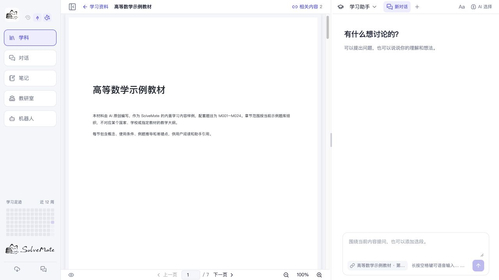
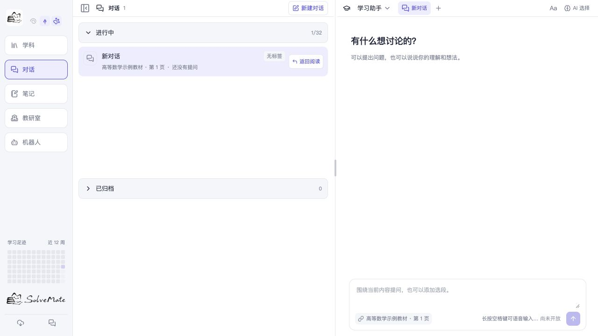
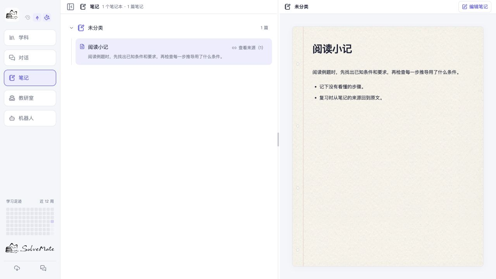
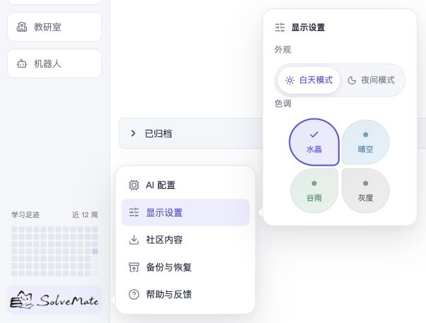
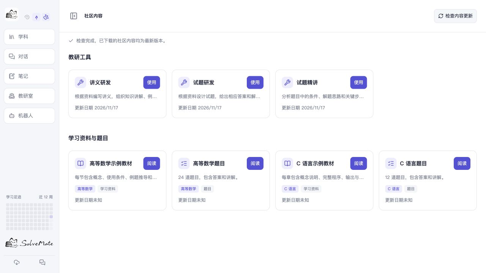
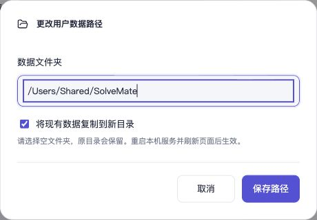
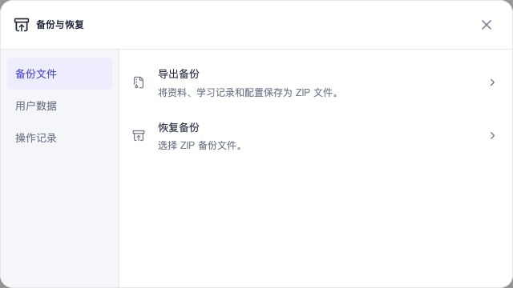

# SolveMate 用户手册

## 1. 主要界面

左侧菜单切换页面，底部的 SolveMate 标志打开「系统设置」。阅读资料时，中间显示正文，右侧是对话栏。拖动两栏之间的分隔线可调整宽度。

### 学科

浏览学习资料和题目，也可以上传 PDF 或 PPTX。阅读时可围绕当前页或指定页码提问，或选中文字添加到对话或笔记。在阅读栏右上角点击「相关内容」，可找回围绕这份资料保存的对话和笔记。

### 对话

左侧列表管理已有和归档的对话，右侧通过页签切换对话。从「返回阅读」会一起打开原来的资料位置和对话，可以对照原文继续讨论。教研室的对话可通过「返回教研室」继续处理。

### 笔记

阅读资料或聊天时，选中文字即可加入笔记。按笔记本浏览和编辑笔记，点击条目旁的来源图标可查看原资料或对话。同一笔记本内可以多选合并笔记，右键笔记本可导出 PDF。

### 教研室

要整理复习讲义、生成练习题或分析错题，可以选好资料和工具，再在右侧对话栏说明任务。工具选择窗口可以选择或新建工具，分别查看和编辑 Skill、输出模板。修改后另存为一份自定义工具。

### 机器人

设置机器人的名称、角色指令和使用的 AI，也可以导入或导出配置。已保存的机器人可在对话栏选择。

## 2. 主要配置

### 连接 AI 服务

打开「系统设置 → AI 配置」，选择本机已安装并配置好的 AI 服务，点击「检测连接」。如界面要求填写安装路径，填写后再检测。检测成功后选好模型，点击「保存配置」。要将该模型用作全局默认，点击「设为默认」。

只想调整当前对话时，打开对话栏右上角的「AI 选择」，从已连接的服务中选择模型。模型支持推理等级时，也可以在这里调整。

### 调整显示

在「系统设置 → 显示设置」切换白天、夜间模式和色调。对话字号通过对话栏上方的「Aa」调整，PDF 则用阅读栏底部的缩放控件。

## 3. 社区内容

从「系统设置 → 社区内容 → 打开社区内容页」进入，可下载学习资料、题目和教研工具。下载后的资料和题目可以在「学科」中打开，工具可以在「教研室」中选择。

点击「检查内容更新」查看哪些条目有新版，再在对应条目上点击「更新」。

如果需要连接其他社区内容服务，在「系统设置 → 社区内容」填写完整服务地址并保存。

## 4. 数据与备份

资料、对话、笔记和配置保存在本机。在「系统设置 → 备份与恢复 → 用户数据」可以查看实际保存位置。

要**更改路径并迁移数据**，选择一个空文件夹，勾选「将现有数据复制到新目录」并保存路径。桌面版退出并重新打开后生效，网页版需要重启本机服务并刷新页面。

要**导出备份**，在「备份文件」中选择「导出备份」，保存生成的 ZIP 文件。换电脑时可用这个文件转移资料、记录和应用配置。

**恢复备份会替换当前资料和记录。** 应用会先备份当前数据。确认要替换后，在「备份文件」中选择「恢复备份」，打开之前导出的 ZIP 文件并确认。

第三方 AI 服务的登录信息和原生会话由各服务管理。换电脑后，需在对应服务中重新准备使用环境。
