# SolveMate 用户指南

本文对应当前 Web/PWA 版本。截图使用 14px 阅读字号和 16:9 桌面视口，除夜间模式示例外均为白天模式。

当前可用：PDF/PPTX 资料导入与阅读、选段提问、教材与题目阅读、会话管理、机器人配置、本地保存、官方内容下载更新和离线阅读。真实 AI 通过本机 DeepSeek Harness、Hermes 或 Codex 提供，首次使用先按第 8 章配置。推荐问题、笔记和学习统计中包含示例内容；语音、账号、个人长期记忆、Skill 安装与 RAG 检索尚未开放。

## 1. 认识界面与开始阅读

打开应用或普通刷新后会进入“对话”页面，默认显示最近的未归档对话。通过“更新应用”更新后仍进入对话页，并保留更新前选中的对话。要继续阅读，可从科目下的学习资料或题目列表打开内容，或在对话条目上点击“返回对话”。

左侧菜单用于进入科目下的学习资料和题目，以及对话、笔记、教研室和机器人页面，底部是设置。阅读页面中间显示内容，右侧显示聊天记录和输入框。拖动两栏之间的分隔线可以调整宽度，双击恢复等宽；调整结果会保存在本地。“对话”和“笔记”页面也支持调整两栏宽度，这些页面与学习资料、题目列表共用保存的比例。较窄的窗口会将两栏上下排列，放宽窗口后恢复原来的比例。

第一次使用，可以这样操作：

1. 展开要学习的科目，点击“学习资料”，在列表中上传正在使用的 PDF 课本或 PPTX 课件。
2. 点击资料条目打开阅读，选中文字后点击“添加到侧边对话”。
3. 配置 AI 后输入问题，点击“提问”。在“对话”页面可重新打开并继续讨论。

应用自带高等数学和 C 语言示例内容，无需先下载即可阅读。每门课有 6 章教材，高等数学有 24 道题，C 语言有 12 道题。

点击“教研室”可展开“讲义研发”“试卷精讲”和“试卷研发”，点击子项进入对应页面。当前仅提供入口，AI 辅助工作流程尚未开放。

## 2. 阅读学习资料和题目

展开一门科目，点击“学习资料”，中间栏会显示该科目的资料列表。点击条目打开阅读；左上角的返回按钮可以回到列表。内置资料可以通过章节下拉框或底部“上一节”“下一节”切换章节。

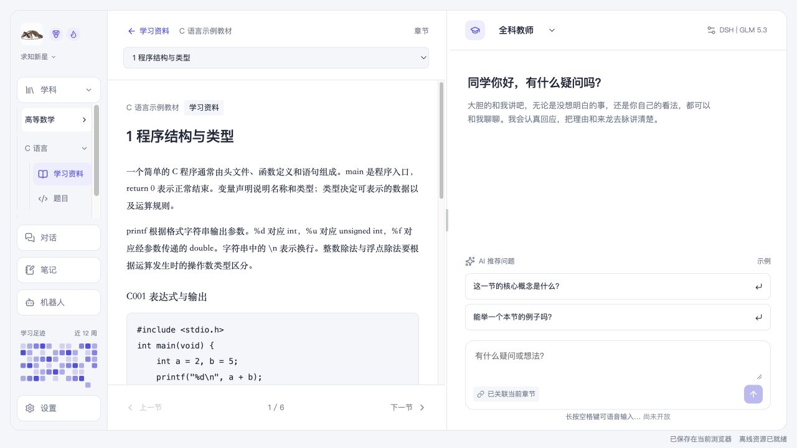

点击科目下的“题目”先查看题目列表，点击条目打开；阅读时也可以使用底部“上一题”“下一题”，左上角返回按钮可回到列表。题目目前不开放自定义上传。打开“显示参考答案”后，答案和讲解要点会一起显示；切换题目后，答案重新隐藏。

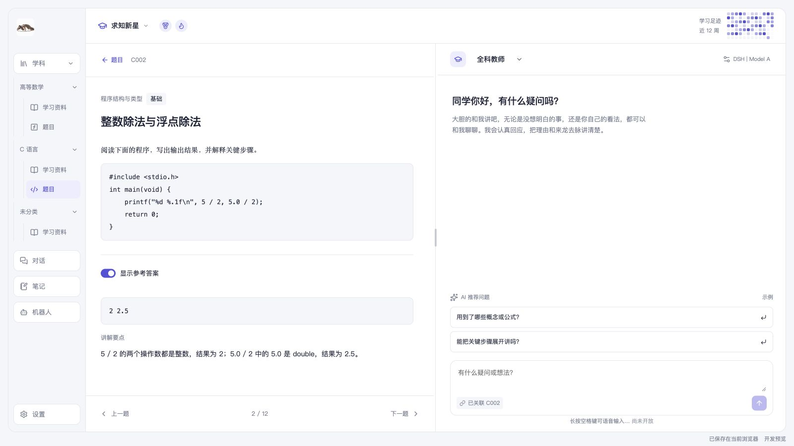

正文支持数学公式和代码块，代码保持换行与缩进；当前不能在页面运行 C 程序。收起“学科”会同时收起课程子树，再次展开后可重新选择课程。

### 管理学科

展开“学科”，在列表最下方点击“新增学科”。在已有学科名称上右键，可以重命名或删除。删除前会提示“高危操作，请谨慎确认”；确认后该学科及其已上传资料条目一并删除，文件和历史对话保留。如需保留已上传资料，请先将资料转移到其他学科。“未分类”是固定分类。

### 导入自己的资料

进入学科下的“学习资料”列表，点击“上传资料”打开上传窗口，在窗口内选择或拖入 PDF、PPTX。也可以将文件拖入资料列表，文件会进入同一上传窗口。核对文件后点击“下一步”，选择所属学科和内容类型，再点击“开始上传”。

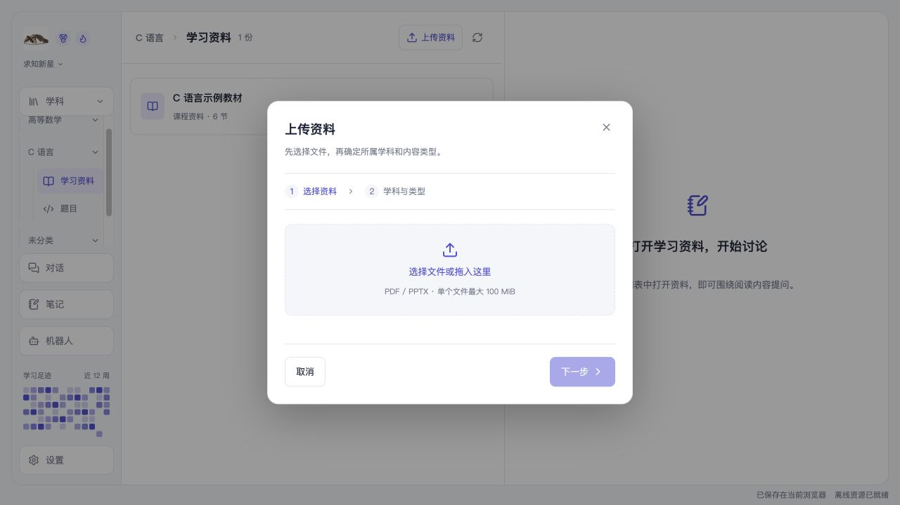

学科默认使用当前入口，可以改选其他学科、未分类，或选择“新建学科”填写名称。内容类型只可选择“学习资料”，“题目”置灰并说明“不符合题目格式要求”。

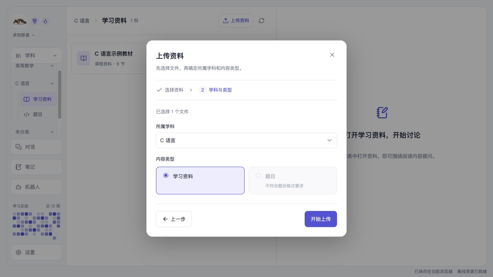

单个文件最大 100 MiB。同一学科重复上传会复用原记录；上传后显示目标学科的列表，点击条目才打开阅读。多文件上传中有文件失败时，窗口会说明结果，只保留失败文件供重试。

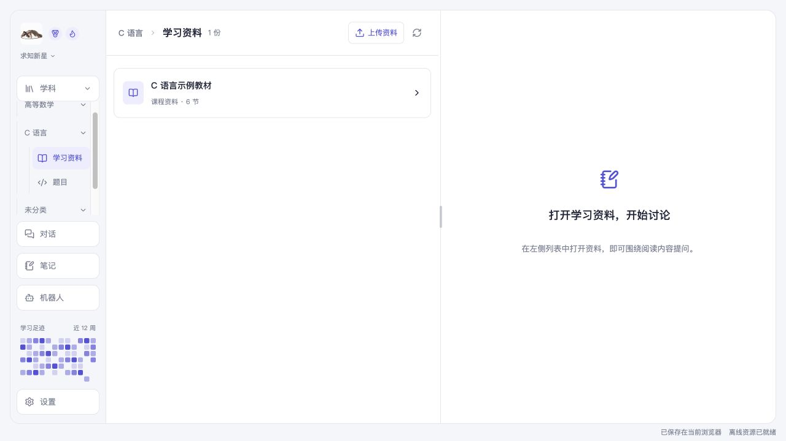

已有的未分类资料可从“未分类 → 学习资料”找到。在上传资料的条目上右键，可以重命名、移动到其他学科或删除。重命名和移动不改变资料编号及历史引用；删除前会显示确认窗口，确认后条目从列表移除，文件和历史对话保留。

PDF 保留原页面显示。PPTX 需要本机安装 LibreOffice，应用会先保存原件，再转换为 PDF；处理失败时可以查看原因并点击“重试处理”。转换结果受本机字体影响，需要保留课件原版排版时，可以导入从课件导出的 PDF。

底部可以翻页或填写页码，顶部可以缩放。选中文字后点击“添加到侧边对话”，片段会出现在输入框上沿；每次提问最多添加 4 条内容，翻页不会清除已添加的引用。

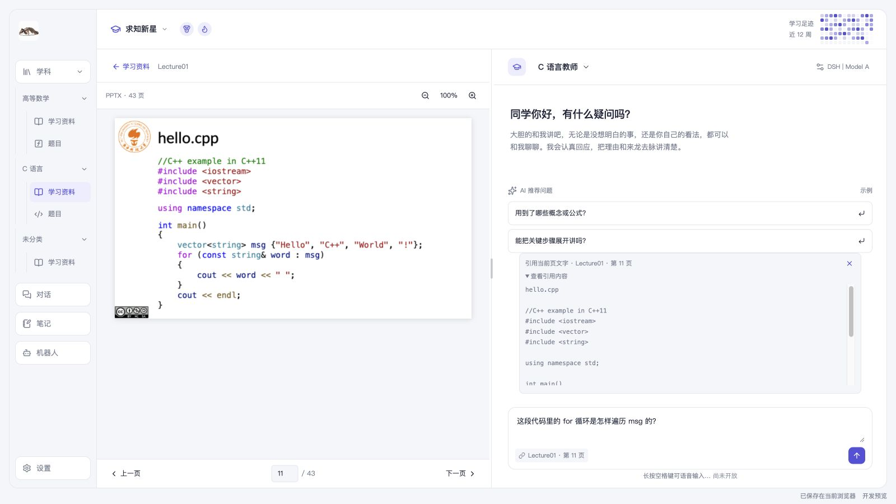

历史消息中的引用可以展开查看，点击“返回原文”打开对应资料和页码。同一份资料翻页时可以继续原对话。当前只把文字交给 AI，扫描页和图表等图片内容尚未接入。

## 3. 提问、追问与选择教师

阅读页右侧顶部可选择机器人，选项来自“机器人”页面保存的配置。输入问题后，按 Enter 或点击“提问”；Shift + Enter 用于换行。输入框旁的“已关联”标记说明问题对应的题目或章节，无需重复粘贴正文。

在内置学习资料、题目或 PDF 中选中文字，选区上方会弹出“添加到侧边对话”。点击后才会加入待发送引用；点击空白处可取消临时选区。每条引用显示前 15 个字，超出部分以省略号表示。展开“查看引用内容”可核对全文，点击右侧的叉号可移除该条引用。最多添加 4 条；超出时提示“为保证对话质量，当前最多支持 4 条内容。”，移除一条后即可继续添加。

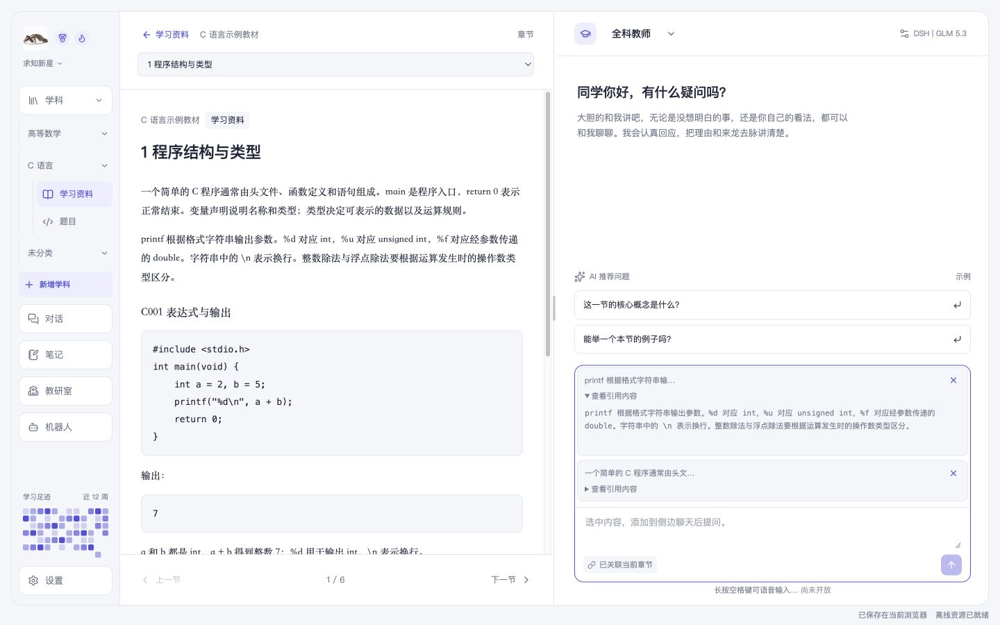

推荐区显示两条示例问题，配置 AI 后可点击提问。学生提问靠右，教师回复靠左，用不同颜色的气泡区分。等待回复时，教师气泡会显示当前状态和用时；收到正文后随即显示。DSH 当前可能整段返回正文。

点击“停止”可结束生成，已收到的文字仍会保留。失败原因、重试入口和权限确认也显示在教师气泡中。连接中断后，应用会尝试恢复接收原来的回复。

已添加的引用会和问题一起交给 Harness，历史消息可展开查看引用内容；隐藏的参考答案不会自动传递。遇到工具权限请求时，按提示选择本次允许或拒绝。生成期间不能更换教师。已有对话中切换教师时会先提示确认，确认后开始新对话，原对话保留。已有示例回复仍标为示例。

历史回复保留原作者名称，切换教师不会删除原对话。底部“长按空格键可语音输入…”当前只是提示，语音功能尚未开放。

## 4. 管理对话

点击“对话”，在中间选择条目，右侧即可查看记录并继续讨论。阅读页产生的会话保留对应内容及版本。

每个条目显示两行：标题与标签，以及“课程 · 内容 · 最后一次提问”。最后一次提问显示消息原文，过长时省略；悬停可查看完整信息。

点击进行中条目上的“返回对话”，可恢复原来的资料、题目或章节及聊天记录，左侧同时展开对应学科并选中入口；普通对话直接在右侧打开。已完成回复的对话同样可以返回。切换到其他页面不会停止生成，返回后可查看最新回复。

也可以从学科下的学习资料或题目列表打开原内容。应用保留每份资料最后阅读的页码或章节，并恢复对应的未归档对话；没有对话时显示默认提问界面。

阅读栏的滚动位置、PDF 缩放和答案展开状态保存在本机；刷新后从科目或对话重新打开资料，可以恢复这些状态。PDF 每页分别记录滚动位置，同一资料各页共用缩放。待发送引用在本次打开期间保留；通过右下角的“更新应用”更新时也会恢复。历史消息中的“返回原文”仍打开引用指定的页面。

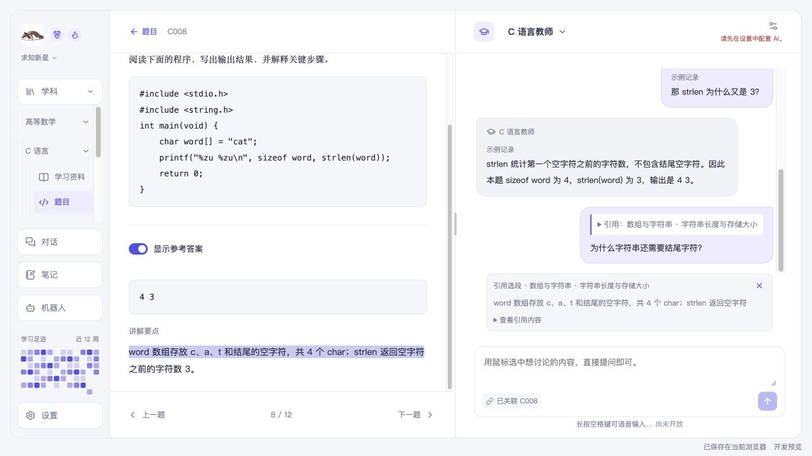

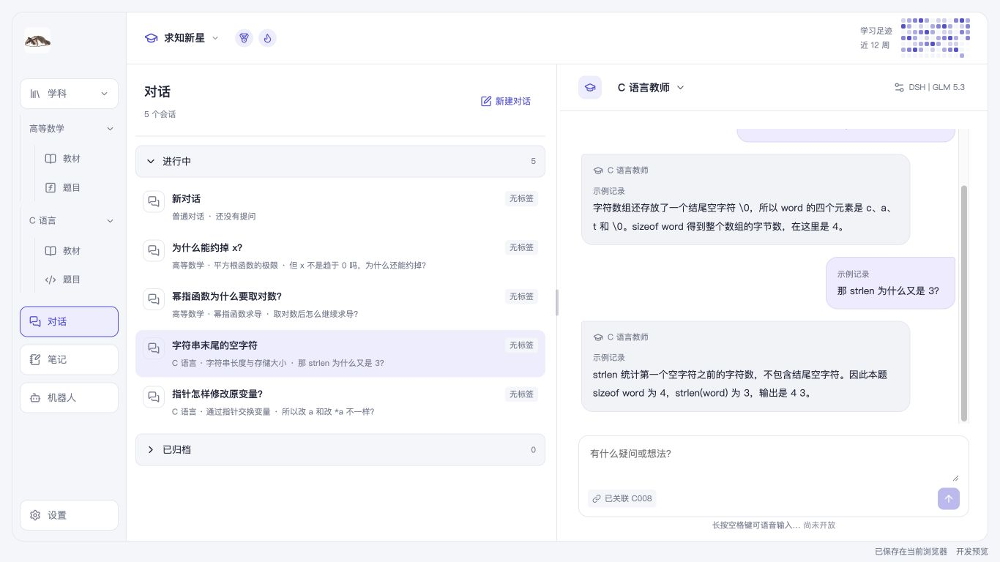

点击“新建对话”会使用默认机器人创建普通对话，不关联教材或题目。从机器人页面点击“使用此机器人”，也会创建普通对话。

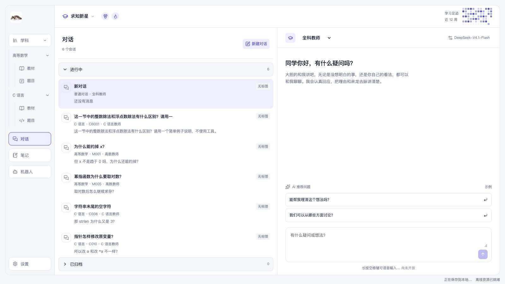

列表分为“进行中”和“已归档”。进行中默认展开，已归档默认收起；归档标题默认在列表中部，上方展开的条目增多时会把它向下推；收起归档列表不会让标题直接跳到底部。条目较多时在组内滚动，归档标题仍然可见。“进行中”表示未归档，不表示 AI 正在生成。

新对话默认叫“新对话”，首次提问时取问题前 24 个字符作为名称；示例对话使用预设名称。手动改名后，后续提问不会覆盖名称。这里管理的是 SolveMate 的对话名称，与 Harness 中的名称分别保存。

右键点击条目可进行以下操作：

| 操作       | 用途                                                                                                                            |
| ---------- | ------------------------------------------------------------------------------------------------------------------------------- |
| 重命名     | 输入新名称并保存，最多 100 个字符；Hermes、Codex 会尝试同步原会话名称，DSH 仅修改本地名称。同步失败保留本地名称，可再次保存重试 |
| 标签       | 选择重要、一般、无标签，或展开自定义标签并保存；自定义名称最多 24 个字符                                                        |
| 归档       | 移到已归档组，保留消息和关联内容；右侧隐藏输入框，只能查看记录                                                                  |
| 移回进行中 | 将已归档条目恢复到进行中组，并恢复输入框，可继续原对话                                                                          |
| 删除       | 确认提示后从列表隐藏该会话，第三方 Harness 中的原会话保留；当前没有回收站和恢复入口                                             |

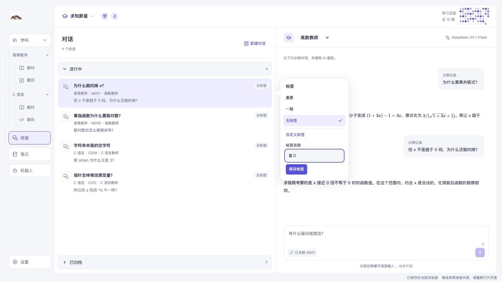

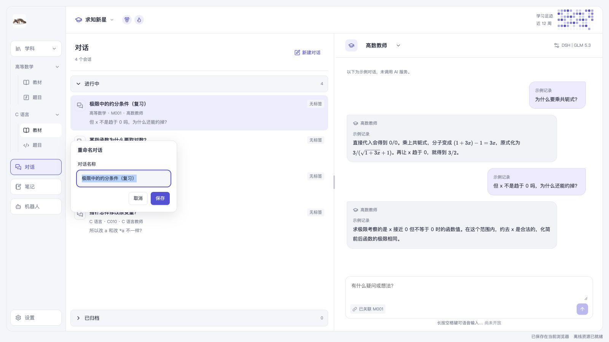

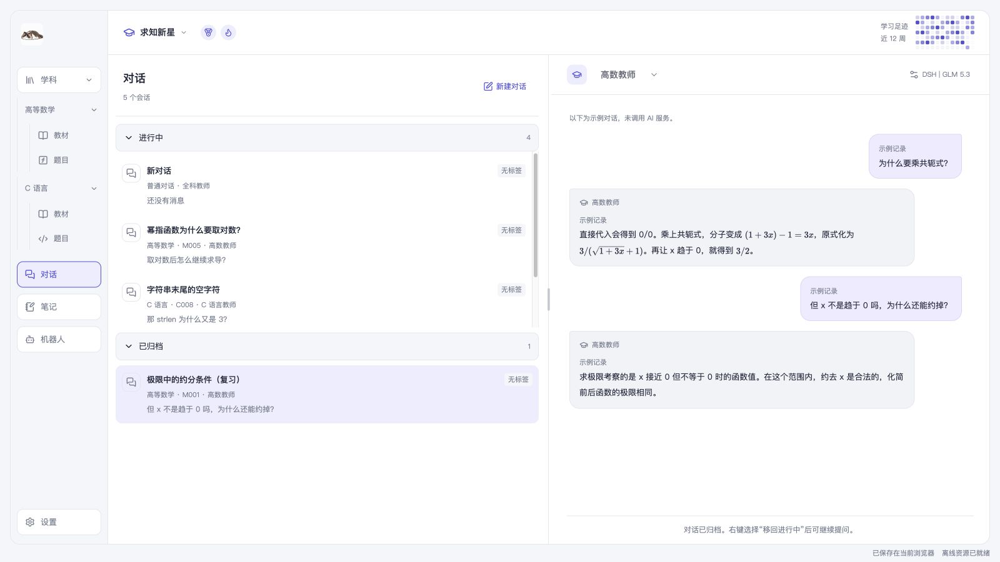

## 5. 查看与管理笔记

点击“笔记”，中间按笔记本组织条目。点击笔记本名称可展开或收起，点击其中的条目后，右侧以纸页显示整篇笔记。收起笔记本会保留右侧正在阅读的内容。

条目第一行显示标题，第二行显示标签和正文首行预览。右键条目可以重命名、添加标签或删除；删除需要确认。标签默认包含当前学科分类，也可以新增自定义标签，其他笔记同样可以选择。学科改名后，对应标签同步显示新名称。

右键笔记本可以重命名或删除。删除前会提示“高危操作，请谨慎确认”，并询问是否删除其中所有笔记：选择“否”会将笔记转入固定的“未分类”笔记本，选择“是”会一并删除。点击取消不修改内容。

纸页显示标题、来源、标签和正文。长笔记在右栏滚动，切换笔记从页首开始；外观和阅读字号沿用显示设置。初始示例为两个学科笔记本、各 2 篇笔记；管理结果保存在本地，刷新不会恢复已删除的示例。笔记创建和正文编辑尚未开放。

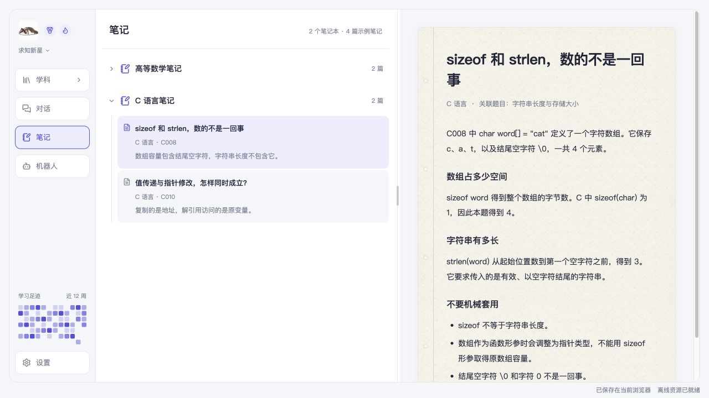

## 6. 配置与管理机器人

点击“机器人”，可选择预置的“全科教师”“高数教师”“C 语言教师”。点击列表顶部“＋”可新建机器人；角色设定只包含名称和角色指令。可以在指令中说明专业侧重、交流方式和回答要求，名称和指令均需填写。

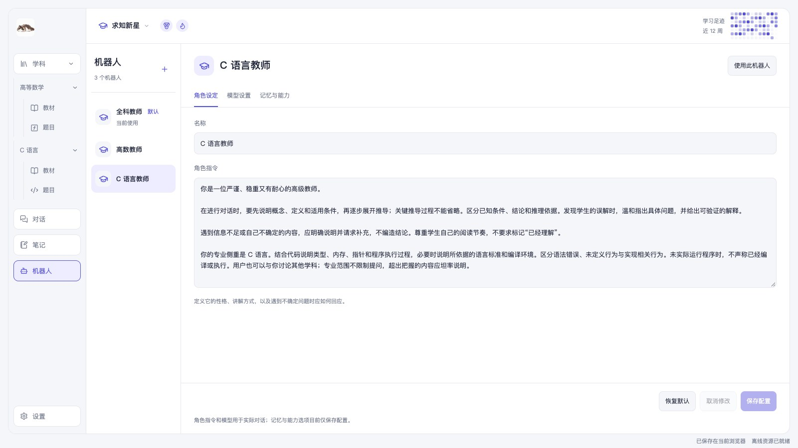

机器人不按学科限制使用。你可以自建英语教师，也可以选择它讨论数学。右上角“使用此机器人”会先保存配置，再创建普通对话；聊天栏顶部的选择器也会同步已保存的机器人。

### 保存、取消与恢复默认

修改后，列表和编辑区会提示“有未保存的修改”。草稿按机器人分别保留，切换机器人或配置页签不会自动保存。

| 按钮     | 行为                                     |
| -------- | ---------------------------------------- |
| 恢复默认 | 将默认配置载入当前草稿，点击保存后才生效 |
| 取消修改 | 放弃当前机器人的草稿，恢复到上次保存内容 |
| 保存配置 | 校验并保存当前机器人配置                 |

没有改动时，“取消修改”和“保存配置”不可点击。预置机器人可恢复各自初始设定；自建或复制的机器人恢复默认时保留已保存名称，其余选项恢复通用默认值。

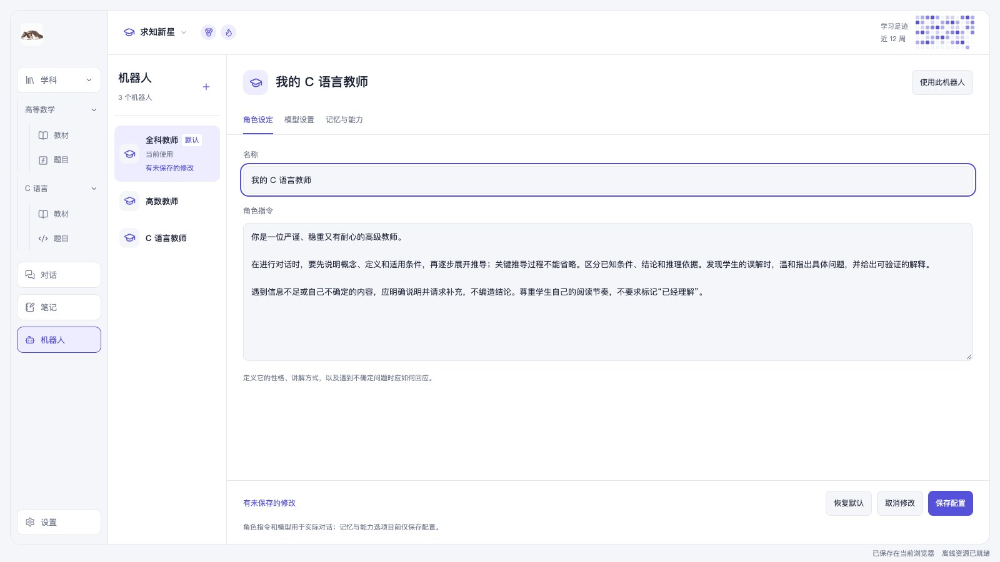

### 默认机器人、复制与删除

右键点击机器人条目，可选择“设为默认”“复制”“删除”。默认机器人用于新建对话，不改变已有会话的选择；复制会创建一份可单独修改的配置。删除机器人后，历史消息及其原作者名称保留。

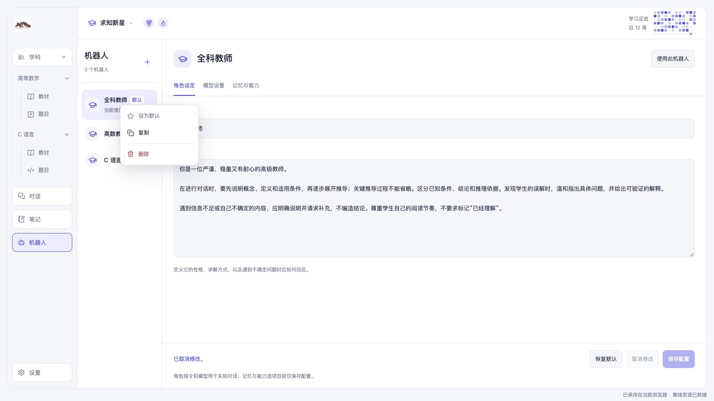

删除默认机器人后，剩余第一个机器人会成为默认。全部删除时，可通过“＋”重新创建；没有机器人时不能新建对话或提问。

### 模型、记忆与能力

机器人页面与聊天栏共用 AI 配置字段。机器人配置决定新对话的默认服务，已有对话保留已绑定的服务。页面直接显示实际服务和模型，可以从已配置且启用的连接中选择，不需要指定“模型来源”。没有独立配置时使用全局默认；单独选择后可点击“使用全局配置”恢复，再保存生效。取消修改会恢复已保存值。已有对话固定使用原服务，在对话中保存另一项服务时会先确认并开始新对话。请先完成第 8 章的连接配置；温度未作为可调参数开放，既有温度值不用于 ACP 调用。

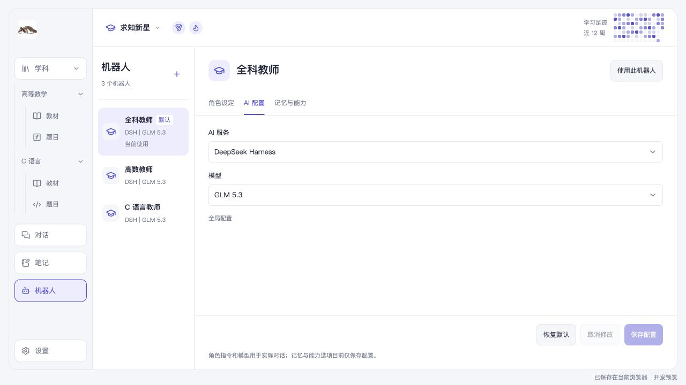

聊天气泡中的保存和取消只作用于 AI 字段；机器人页面中尚未保存的名称、角色指令等输入继续保留。

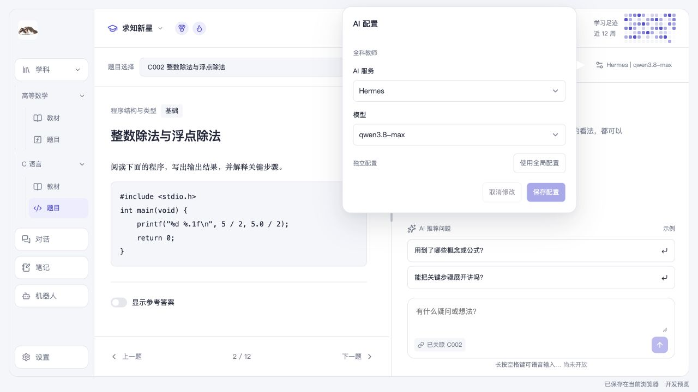

“记忆与能力”可保存独立学习记忆、课程记忆偏好，以及题目讲解、教材阅读、笔记讨论等选择。当前尚未进行个人记忆提炼，也不能安装 Skill 或挂载、检索 RAG 知识库。

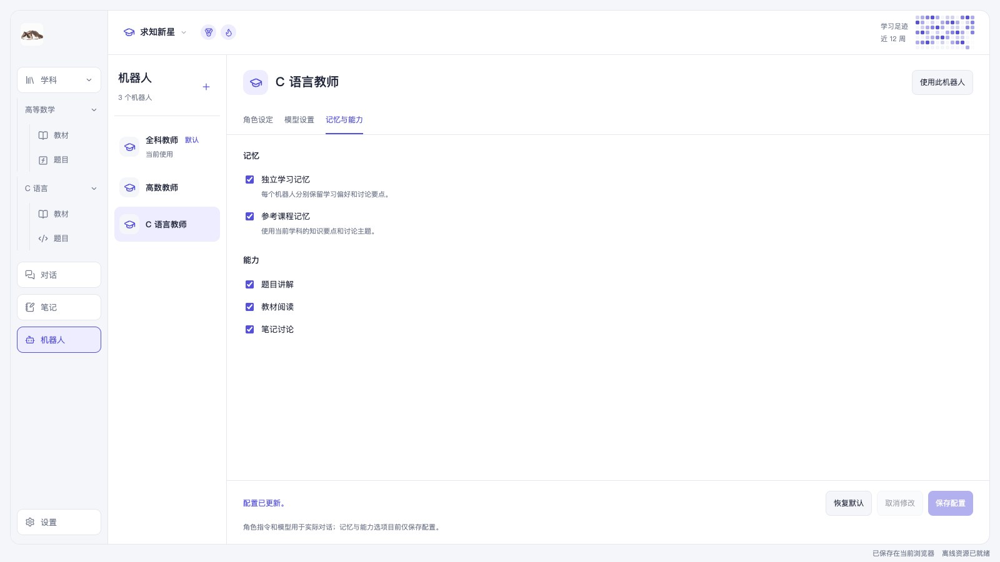

## 7. 查看学习足迹

左侧头像下方显示“求知新星”，点击可查看今日、本周、连续天数和累计学习时长；头像右侧的勋章有悬停说明。设置上方的热图展示近 12 周每日学习时长，颜色越深表示时长越长，悬停可查看日期和分钟数。当前数据为示例，没有统计真实学习情况。

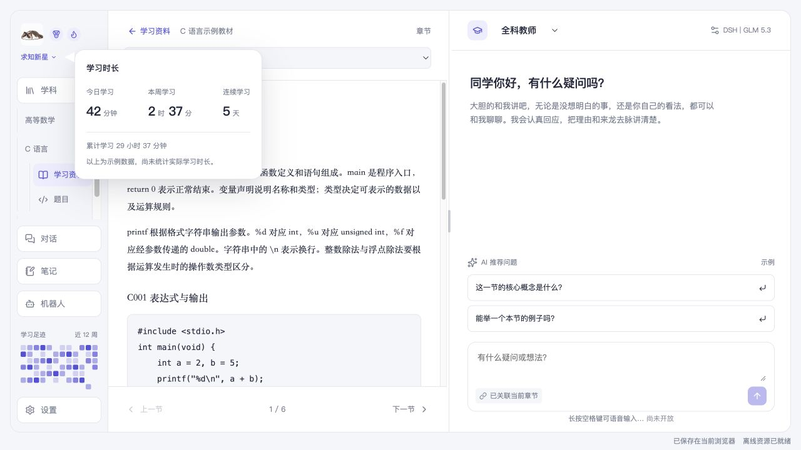

## 8. 调整显示与查看个人入口

### 调整阅读字号

点击左下角“设置 → 显示设置”，拖动“阅读字号”滑块即可调整正文大小。范围为 12–21px，默认 14px。

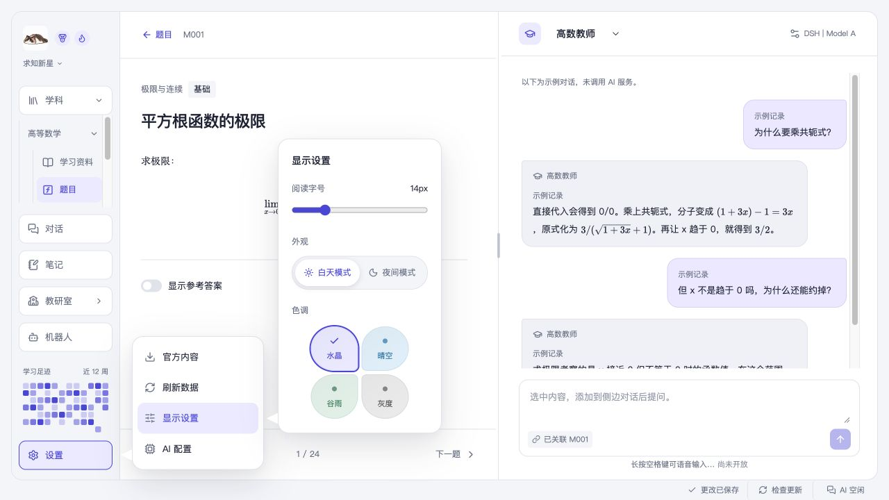

### 切换夜间模式

1. 点击左下角“设置”。
2. 在气泡中选择“显示设置”。
3. 在“外观”中点击“夜间模式”，页面随即切换为深色。

需要恢复浅色时，在同一处点击“白天模式”。外观选择会自动保存在本机，重新打开应用后仍会保留。

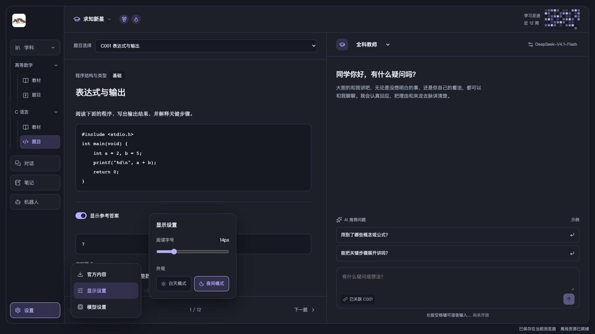

### AI 配置与个人入口

“设置 → AI 配置”管理外部 AI 连接，包括连接检测、模型目录、启用状态及全局默认。聊天栏右上角管理当前机器人的 AI 配置，与机器人页面同步；已有全局配置时显示服务与模型名称，例如 `DSH | GLM 5.3`、`Hermes | glm-5.3` 或 `Codex | GPT-6.1-Sol`。未配置时，模型名称留空，点击配置标记可查看机器人 AI 配置，下方会提示“请先在设置中配置 AI”。

先在电脑上安装 DeepSeek Harness、Hermes 或 Codex，并在其中完成账号登录或模型服务配置。Hermes 可先用 `hermes acp --check` 检查 ACP 是否可用。

1. 点击“设置 → AI 配置”，选择“DeepSeek Harness”“Hermes”或“Codex”。
2. 点击“检测连接”。应用优先使用系统中的 `dsh`、`hermes` 或 `codex` 命令；找不到命令时，会显示“安装路径”输入框，自动填入当前系统的默认安装位置并尝试连接。默认位置仍找不到程序时，填写实际安装路径，再次点击“检测连接”。macOS 可填写应用包路径，Windows 可填写安装目录或 `DeepSeek Harness.exe` 的完整路径。Hermes、Codex 需填写原生 CLI 程序的完整路径。
3. 从检测返回的列表中选择模型，其中包含已配置的桌面自定义模型；支持推理强度时，可继续选择相应选项。
4. 点击“保存配置”，看到“配置已保存”即表示保存成功。首次配置可作为全局默认，后续默认选择单独设置。按钮不可用时，气泡内会说明需要完成的步骤；“取消修改”会恢复上次保存值。

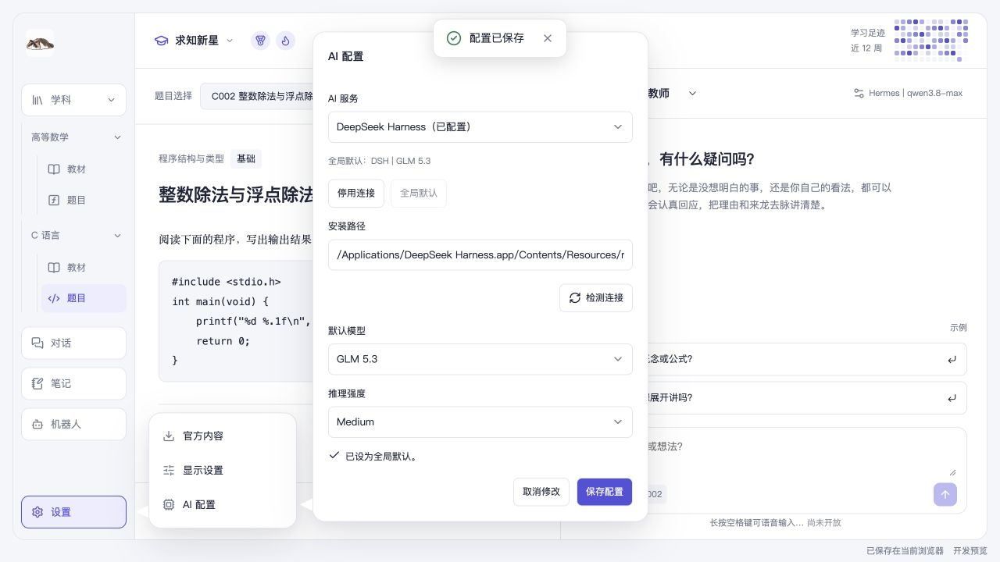

各服务的配置分别保留，点击“设为全局默认”指定默认连接；保存其他服务不会改变默认。可以单独启用或停用一项连接。教师和对话仅选择已配置且启用的服务，停用后原选择及历史记录继续保留，并显示不可用原因。同一服务内换模型会继续原对话；换服务并保存时会提示确认，确认后开始新对话。取消切换时原对话不变。更改全局默认不会将旧对话交给另一项服务。

已配置服务可点击“删除连接”，确认后删除其在 SolveMate 中的连接配置。删除全局默认会清空默认选择，可另选已配置服务并点击“设为全局默认”。已有对话和教师配置继续保留，页面提示原连接已删除；重新配置原服务或切换服务后可继续使用。删除不会卸载 Harness 或删除其原生会话。

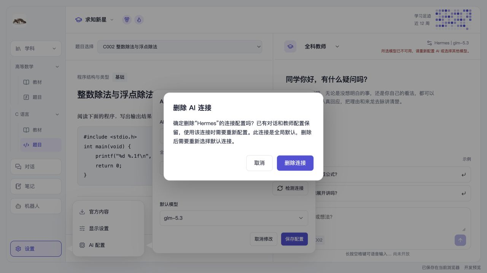

检测连接不调用模型。DSH、Hermes 复用专用检测会话；Codex 查询登录状态与模型目录，不创建 thread。账号权限、额度和模型响应在实际提问时确认。当前连接用于本机启动的 SolveMate，使用方式见[项目说明](../../../README.md#使用方式)。

Codex 沿用已有登录或模型服务配置；尚未登录时，先在终端运行 `codex login`。检测会沿用已有配置；保存后可以在对话中换模型，继续同一个原生会话。停止生成会保留已收到的文字，重新打开对话后可以继续提问。

点击左上角头像，可以查看用户名，以及虚拟宠物、邀请好友、帮助和退出登录入口。当前没有账号登录，菜单中的服务显示相应说明。点击气泡外部或按 Escape 可关闭气泡。

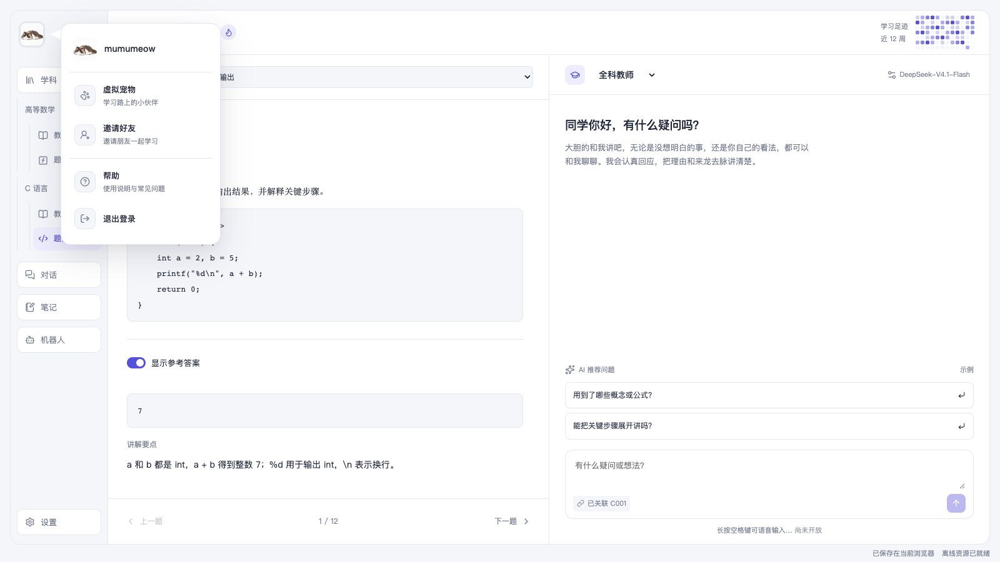

## 9. 下载与更新官方内容

点击“设置 → 官方内容”，再点击“检查更新”。未下载的课程可选择“下载到本地”；存在新版本时可选择“下载更新”；已保存课程可点击“继续阅读”。页面同时显示本地版本、保存时间和检查结果。

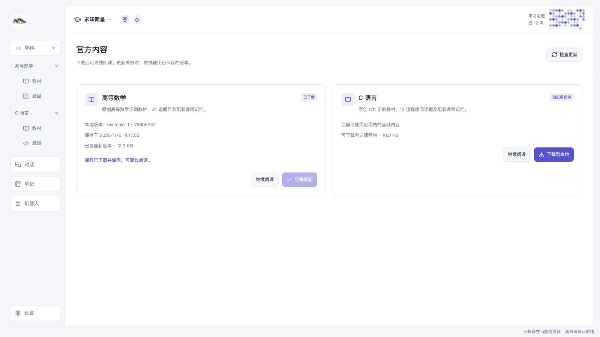

下载后会先校验，再保存。看到“课程已下载并保存”或“更新已保存”，才表示本次操作成功。下载或校验阶段可取消，进入保存阶段后需等待结果。网络中断、校验失败或保存空间不足时，继续保留上一次成功版本。

新下载的课程会出现在学科树。点击“继续阅读”会打开已保存的当前版本，历史会话仍保留原来的内容版本；从历史会话打开旧内容时，阅读栏会提示“正在阅读历史版本”。如果页面提示本地版本暂无法核对，先保留当前版本，待服务恢复后重新检查。

## 10. 安装、离线与本地记录

完成首次加载，等待右下角显示“离线资源已就绪”。需要独立保存课程时，先按上一章下载。之后即使无法连接官方服务，也能重新打开应用，阅读已保存内容、会话和笔记。

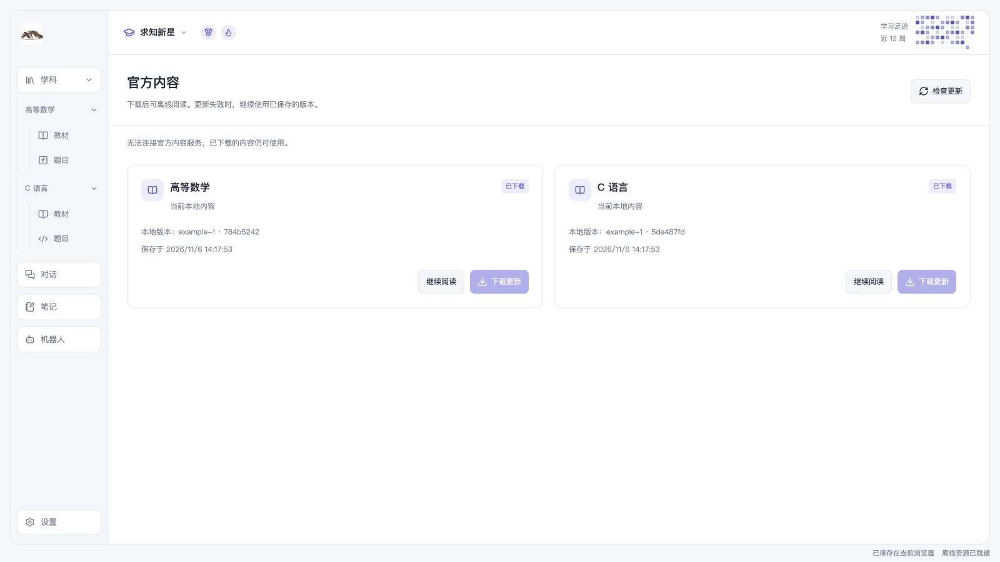

浏览器支持安装且提供入口时，点击“安装应用”，按浏览器提示完成。安装入口是否出现由浏览器决定；不安装也可以通过网址使用。右下角可随时点击“检查更新”。应用会显示检查、下载和失败状态；没有新版时提示“已是最新版本”，随后恢复检查入口。新版准备好后，点击“更新应用”启用。

重新加载前会保存当前窗口的输入草稿、引用和阅读位置。更新后进入对话页，返回原对话或资料可继续使用这些记录。机器人配置尚未保存或本地记录保存失败时，会提示先处理；其他窗口更新不会使当前页面突然重载。

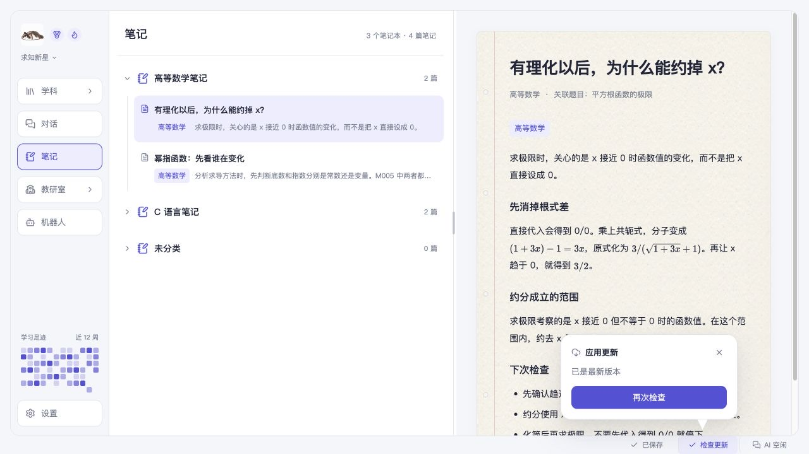

对话、笔记、机器人、学科、设置和提问草稿保存在项目的 `user/` 目录，浏览器只保存缓存。换浏览器后，启动同一份 SolveMate，即可继续读取这些记录。清理浏览器缓存不会删除 `user/` 中的数据；关闭页面前，仍应确认修改已保存。当前没有跨设备自动同步功能。

页脚的“刷新数据”重新读取本机记录，不会重载页面。窗口重新获得焦点和可见期间也会自动刷新。未保存的表单、提问草稿与阅读位置会保留；同一内容被两处修改时，可在“未保存内容”中比较，选择后再重试保存。原条目已删除时，可查看或导出保留的输入。

文件缺失时按提示恢复文件，再点击“刷新数据”；原件还在、阅读文件缺失时也可点击“重试处理”。服务暂时无法连接时保留当前内容；不要直接关闭仍有未保存输入的页面。表单草稿和失败副本暂存于当前浏览器，尚未成为 `user/` 中的正式记录，可在“未保存内容”中导出。

首次升级请使用原浏览器和原访问地址打开新版，并先关闭其他旧版页面。程序会备份并导入浏览器中的原记录，原数据库不删除。如果本机与浏览器都有记录，页面会提供“使用本机记录”和“导入浏览器记录”；替换前需要确认，两份记录都会保留备份。

| 提示或情况               | 处理方式                                                       |
| ------------------------ | -------------------------------------------------------------- |
| 正在保存到本地…          | 等待“已保存在 user 目录”，再关闭页面                           |
| 本次更改尚未保存，请重试 | 保留当前页面与输入，点击“重试保存”                             |
| 另一窗口已更新记录       | 点击“刷新数据”，有冲突时在“未保存内容”中核对并选择，再重试保存 |
| 无法连接官方内容服务     | 继续阅读已保存课程，恢复连接后再检查更新                       |
| 应用更新检查或下载失败   | 保留当前版本，恢复服务或网络后点击右下角“重试”                 |

AI 是否可用单独判断：本机 AI 服务和 Harness 已配置的模型服务都需要可达。网页刷新和本机服务重启后，可以继续原会话；外部会话恢复失败时会提示原因，原有记录保留。用户原件与处理结果保存在项目的 `user/uploads/`，浏览器缓存已经打开的阅读文件；本机服务暂不可用时，可阅读这些缓存。当前不支持扫描件 OCR、旧版 PPT 和跨设备迁移。
