# SolveMate 用户指南

本文对应当前 Web/PWA 版本。截图使用 14px 阅读字号和 1600 × 900 桌面视口，除夜间模式示例外均为白天模式。

当前可用：教材与题目阅读、会话管理、机器人配置、本地保存、官方内容下载更新和离线阅读。真实 AI 尚未接入，点击“保存问题”只保存用户消息。已有回复、推荐问题、笔记和学习统计中包含示例内容；语音、账号、个人长期记忆、Skill 安装与 RAG 检索尚未开放。

## 1. 认识界面与开始阅读

左侧菜单用于切换学科、对话、笔记和机器人页面，底部是设置。阅读页面中间显示内容，右侧显示聊天记录和输入框；较窄的窗口会将阅读与聊天区域上下排列。

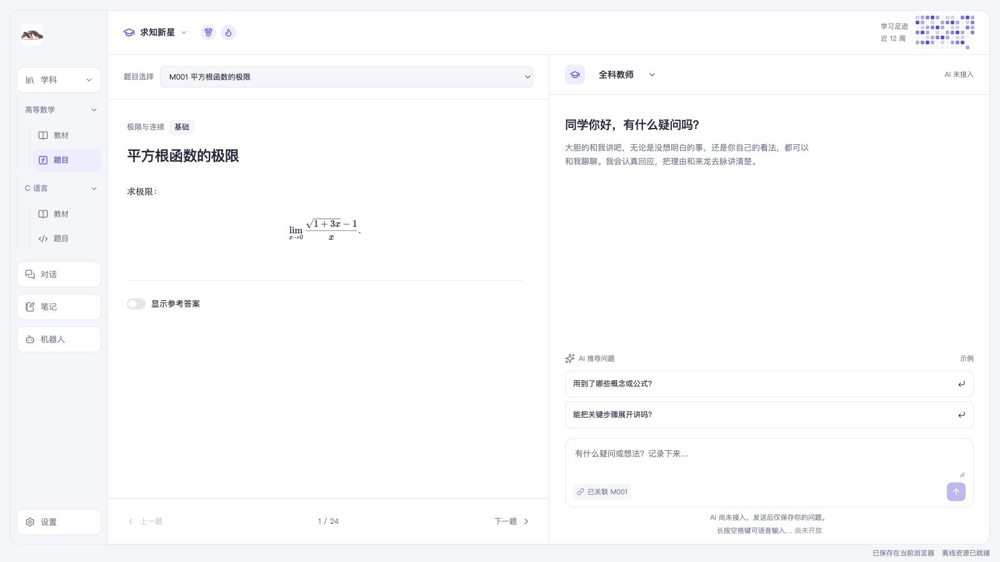

第一次使用，可以这样操作：

1. 展开“学科 → 高等数学”，点击“题目”。
2. 在“题目选择”中选择“M001 平方根函数的极限”。
3. 输入问题，点击“保存问题”。在“对话”页面可重新打开这段记录。

应用自带高等数学和 C 语言示例内容，无需先下载即可阅读。每门课有 6 章教材，高等数学有 24 道题，C 语言有 12 道题。

## 2. 阅读教材和题目

展开一门学科，点击“教材”，再从“教材选择”中选择教材。正文可独立滚动，底部“上一节”“下一节”用于切换章节。

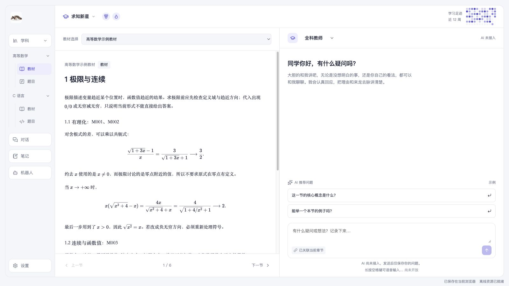

点击“题目”后，可以从“题目选择”中选题，也可以使用底部“上一题”“下一题”。打开“显示参考答案”后，答案和讲解要点会一起显示；切换题目后，答案重新隐藏。

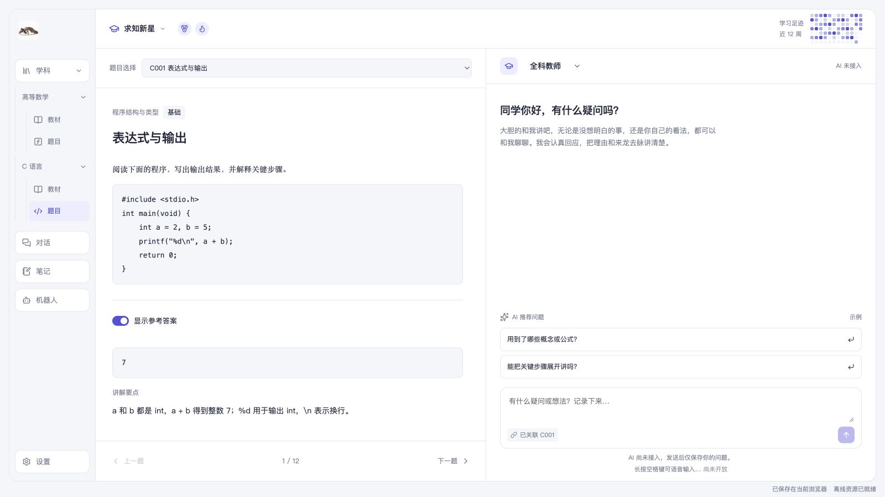

正文支持数学公式和代码块，代码保持换行与缩进；当前不能在页面运行 C 程序。收起“学科”会同时收起课程子树，再次展开后可重新选择课程。

## 3. 保存问题与选择教师

阅读页右侧顶部可选择机器人，选项来自“机器人”页面保存的配置。输入问题后，按 Enter 或点击“保存问题”；Shift + Enter 用于换行。输入框旁的“已关联”标记说明问题对应的题目或章节，无需重复粘贴正文。

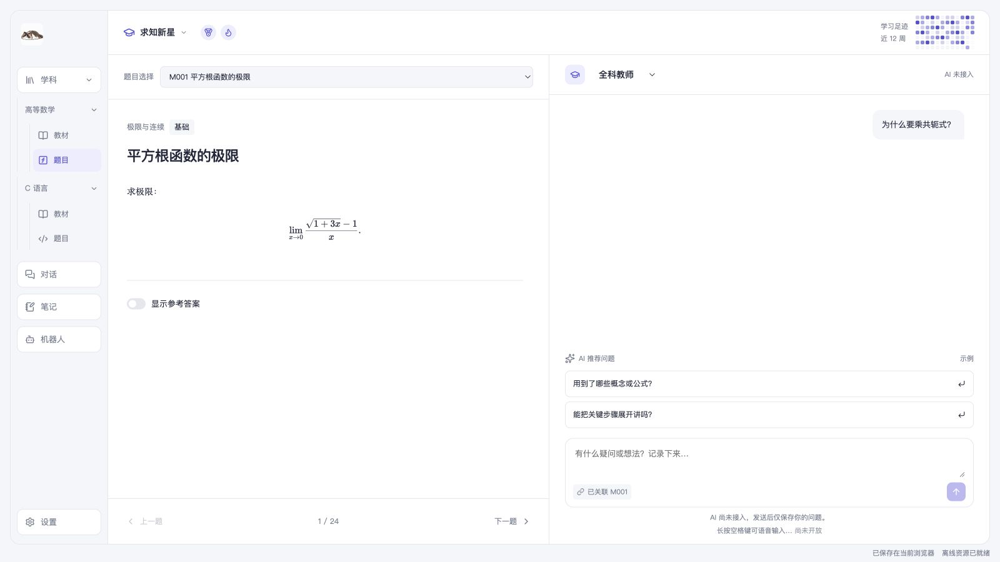

推荐区每次显示两条问题，点击后会作为用户问题保存。当前推荐内容为示例，保存后不会生成新的 AI 回复。已有示例对话会明确标注未调用 AI 服务。

切换机器人会保留聊天记录。历史回复保留原作者名称；所选机器人用于当前对话的后续交流配置。底部“长按空格键可语音输入…”当前只是提示，语音功能尚未开放。

## 4. 管理对话

点击“对话”，在中间选择条目，右侧即可查看记录并继续讨论。阅读页产生的会话保留对应内容及版本。

每个条目显示两行：标题与标签，以及“课程 · 内容 · 最后一次提问”。最后一次提问显示消息原文，过长时省略；悬停可查看完整信息。

点击进行中条目上的“返回对话”，可恢复原来的资料、题目或章节及聊天记录；普通对话直接在右侧打开。已完成回复的对话同样可以返回。切换到其他页面不会停止生成，返回后可查看最新回复。

也可以从科目的教材或题目入口返回。应用保留同课程、同类型的当前阅读内容，并恢复该题目或章节最近的未归档对话；没有对话时显示默认提问界面。

点击“新建对话”会使用默认机器人创建普通对话，不关联教材或题目。从机器人页面点击“使用此机器人”，也会创建普通对话。

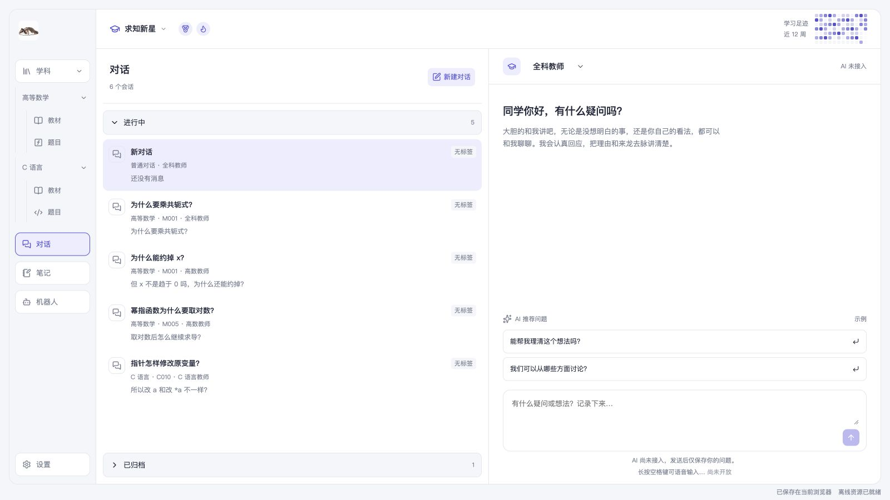

列表分为“进行中”和“已归档”。进行中默认展开，已归档默认收起；条目较多时在组内滚动，归档标题仍然可见。“进行中”表示未归档，不表示 AI 正在生成。

右键点击条目可进行以下操作：

| 操作       | 用途                                                                     |
| ---------- | ------------------------------------------------------------------------ |
| 标签       | 选择重要、一般、无标签，或展开自定义标签并保存；自定义名称最多 24 个字符 |
| 归档       | 移到已归档组，消息和关联内容保留，仍可打开并继续记录                     |
| 移回进行中 | 将已归档条目恢复到进行中组；继续记录本身不会自动取消归档                 |
| 删除       | 从列表隐藏该会话；当前没有回收站和恢复入口                               |

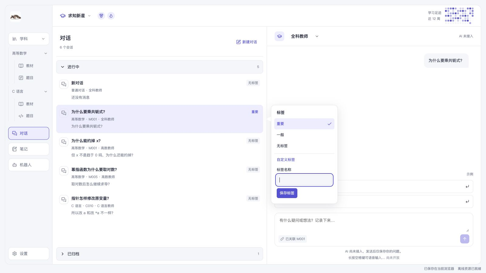

## 5. 查看笔记

点击“笔记”，在中间选择标题，右侧以纸页样式显示整篇笔记，页内依次显示标题、课程与关联题目、正文。长笔记在右栏滚动，切换笔记从页首开始；纸页适配白天与夜间外观，正文沿用显示设置中的阅读字号。列表包含学科、关联题号和摘要。当前提供 4 篇示例笔记供阅读，创建和编辑尚未开放。

## 6. 配置与管理机器人

点击“机器人”，可选择预置的“全科教师”“高数教师”“C 语言教师”。点击列表顶部“＋”可新建机器人；角色设定只包含名称和角色指令。可以在指令中说明专业侧重、交流方式和回答要求，名称和指令均需填写。

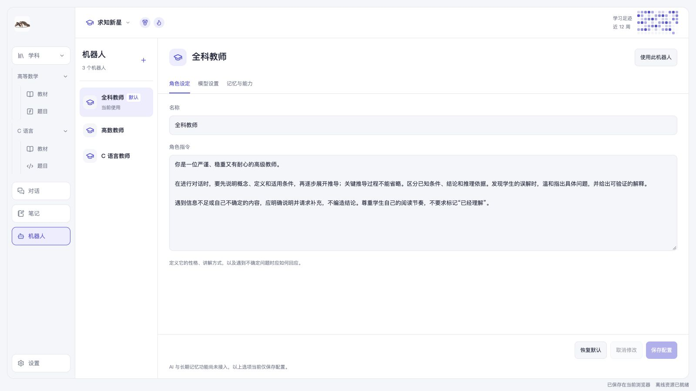

机器人不按学科限制使用。你可以自建英语教师，也可以选择它讨论数学。右上角“使用此机器人”会先保存配置，再创建普通对话；聊天栏顶部的选择器也会同步已保存的机器人。

### 保存、取消与恢复默认

修改后，列表和编辑区会提示“有未保存的修改”。草稿按机器人分别保留，切换机器人或配置页签不会自动保存。

| 按钮     | 行为                                     |
| -------- | ---------------------------------------- |
| 恢复默认 | 将默认配置载入当前草稿，点击保存后才生效 |
| 取消修改 | 放弃当前机器人的草稿，恢复到上次保存内容 |
| 保存配置 | 校验并保存当前机器人配置                 |

没有改动时，“取消修改”和“保存配置”不可点击。预置机器人可恢复各自初始设定；自建或复制的机器人恢复默认时保留已保存名称，其余选项恢复通用默认值。

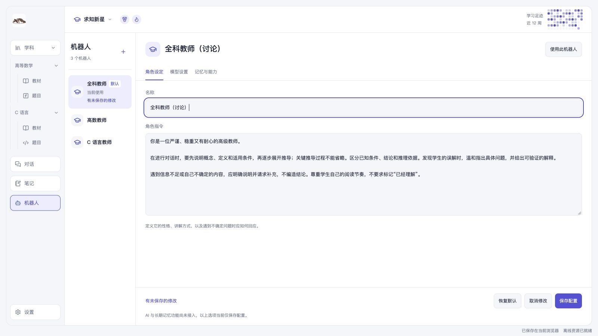

### 默认机器人、复制与删除

右键点击机器人条目，可选择“设为默认”“复制”“删除”。默认机器人用于新建对话，不改变已有会话的选择；复制会创建一份可单独修改的配置。删除机器人后，历史消息及其原作者名称保留。

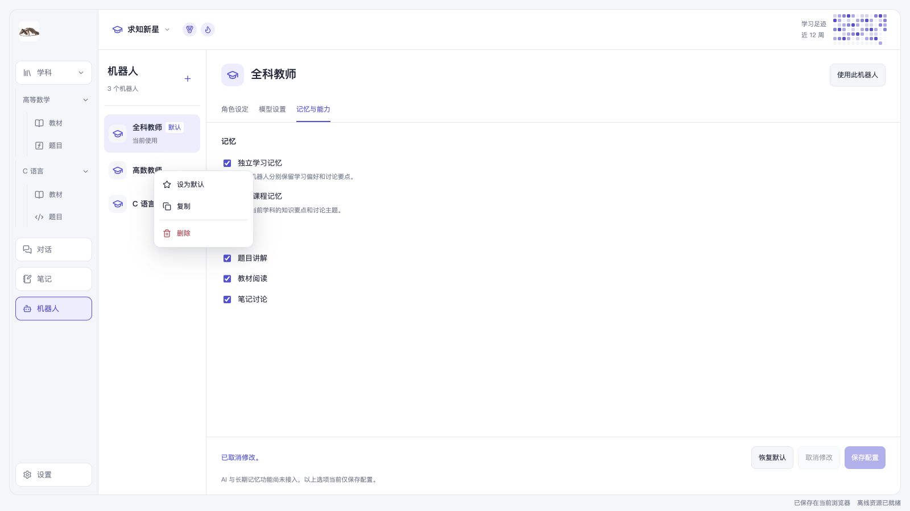

删除默认机器人后，剩余第一个机器人会成为默认。全部删除时，可通过“＋”重新创建；没有机器人时不能新建对话或保存问题。

### 模型、记忆与能力

“模型设置”可选择跟随全局设置，或为当前机器人单独填写模型名称并调整回答发散度。当前仅保存这些选项，不会连接模型服务。

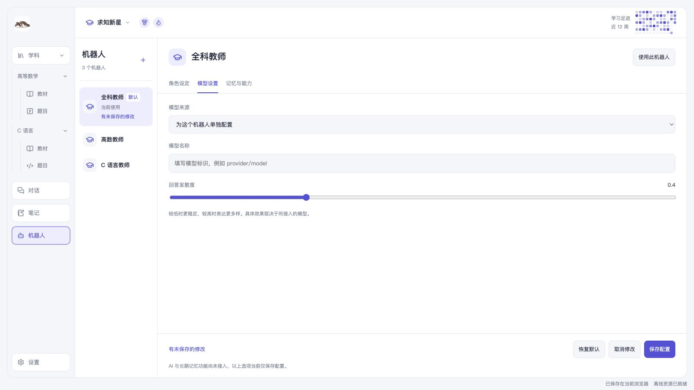

“记忆与能力”可保存独立学习记忆、课程记忆偏好，以及题目讲解、教材阅读、笔记讨论等选择。当前尚未进行个人记忆提炼，也不能安装 Skill 或挂载、检索 RAG 知识库。

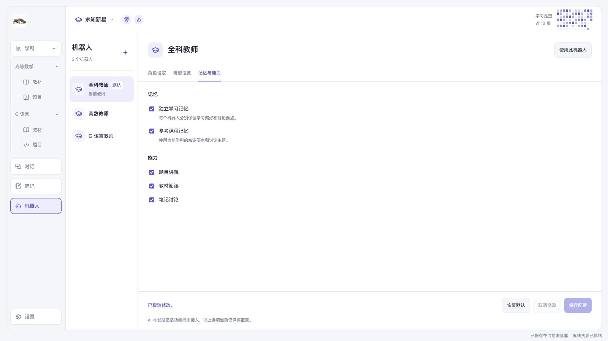

## 7. 查看学习足迹

顶部热图展示近 12 周每日学习时长的示例，颜色越深表示时长越长，悬停可查看日期和分钟数。点击“求知新星”可查看今日、本周、连续天数和累计时长；勋章也有悬停说明。当前没有统计真实学习情况。

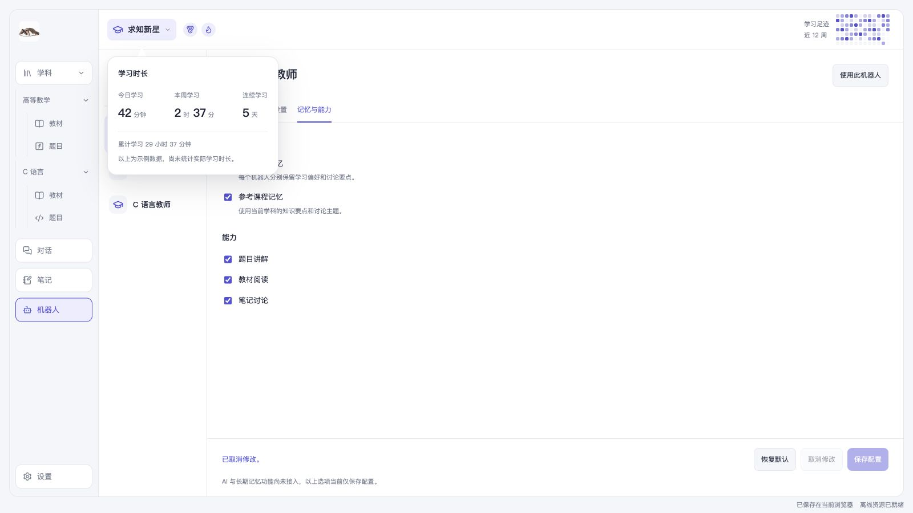

## 8. 调整显示与查看个人入口

### 调整阅读字号

点击左下角“设置 → 显示设置”，拖动“阅读字号”滑块即可调整正文大小。范围为 12–21px，默认 14px。

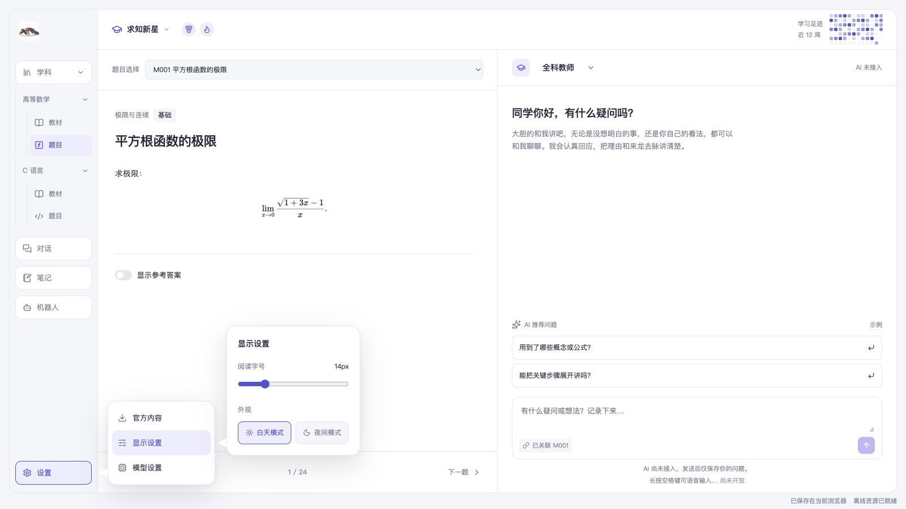

### 切换夜间模式

1. 点击左下角“设置”。
2. 在气泡中选择“显示设置”。
3. 在“外观”中点击“夜间模式”，页面随即切换为深色。

需要恢复浅色时，在同一处点击“白天模式”。外观选择会自动保存在当前浏览器，重新打开应用后仍会保留。

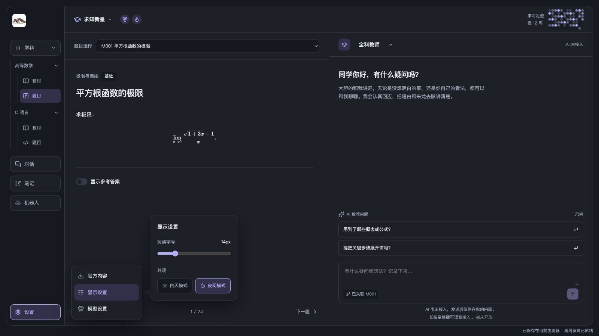

### 模型设置与个人入口

“设置 → 模型设置”是全局模型入口，当前显示“尚未接入模型”。

点击左上角头像，可以查看用户名，以及虚拟宠物、邀请好友、帮助和退出登录入口。当前没有账号登录，菜单中的服务显示相应说明。点击气泡外部或按 Escape 可关闭气泡。

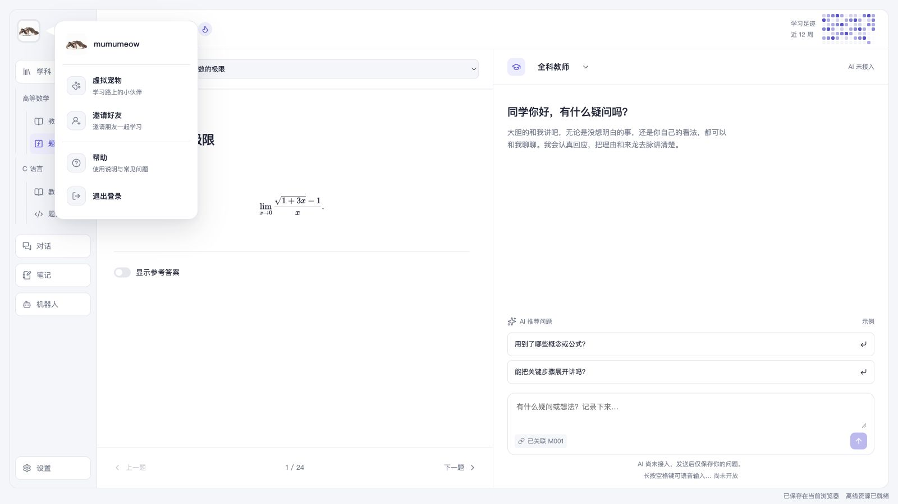

## 9. 下载与更新官方内容

点击“设置 → 官方内容”，再点击“检查更新”。未下载的课程可选择“下载到本地”；存在新版本时可选择“下载更新”；已保存课程可点击“继续阅读”。页面同时显示本地版本、保存时间和检查结果。

下载后会先校验，再保存。看到“课程已下载并保存”或“更新已保存”，才表示本次操作成功。下载或校验阶段可取消，进入保存阶段后需等待结果。网络中断、校验失败或保存空间不足时，继续保留上一次成功版本。

新下载的课程会出现在学科树。点击“继续阅读”会打开已保存的当前版本，历史会话仍保留原来的内容版本；从历史会话打开旧内容时，阅读栏会提示“正在阅读历史版本”。如果页面提示本地版本暂无法核对，先保留当前版本，待服务恢复后重新检查。

## 10. 安装、离线与本地记录

完成首次加载，等待右下角显示“离线资源已就绪”。需要独立保存课程时，先按上一章下载。之后即使无法连接官方服务，也能重新打开应用，阅读已保存内容、会话和笔记。

浏览器支持安装且提供入口时，点击“安装应用”，按浏览器提示完成。安装入口是否出现由浏览器决定；不安装也可以通过网址使用。出现“更新应用”时，先确认本地更改已保存，再点击更新。

记录保存在当前浏览器的当前站点。更换浏览器、站点或设备，不会自动带上已有数据；清理站点数据会移除本地内容和记录。当前尚无备份导出和跨设备同步功能。

| 提示或情况               | 处理方式                                                           |
| ------------------------ | ------------------------------------------------------------------ |
| 正在保存到本地…          | 等待“已保存在当前浏览器”，再关闭页面                               |
| 本次更改尚未保存，请重试 | 保留当前页面与输入，点击“重试保存”                                 |
| 另一窗口已更新记录       | 先保留本页尚未保存的输入，再点击“重新读取”，避免覆盖另一窗口的结果 |
| 无法连接官方内容服务     | 继续阅读已保存课程，恢复连接后再检查更新                           |
| 离线资源准备失败         | 网络可用时重新打开页面，确认资源就绪后再离线使用                   |

当前尚未接入 AI，对话中暂时没有 AI 回复。
