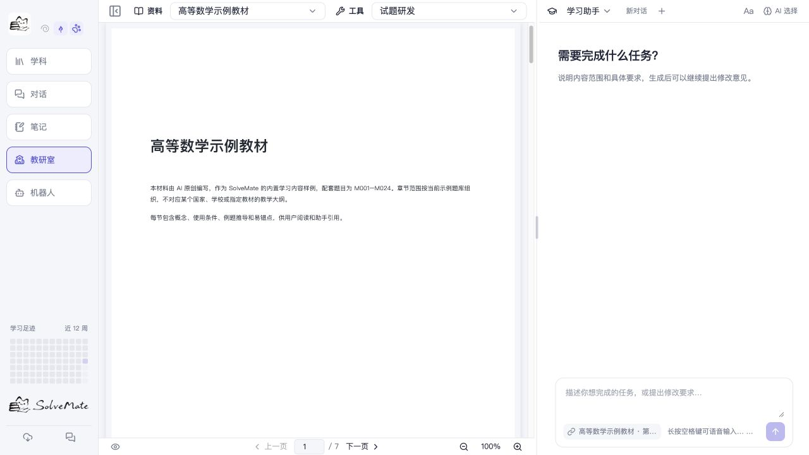
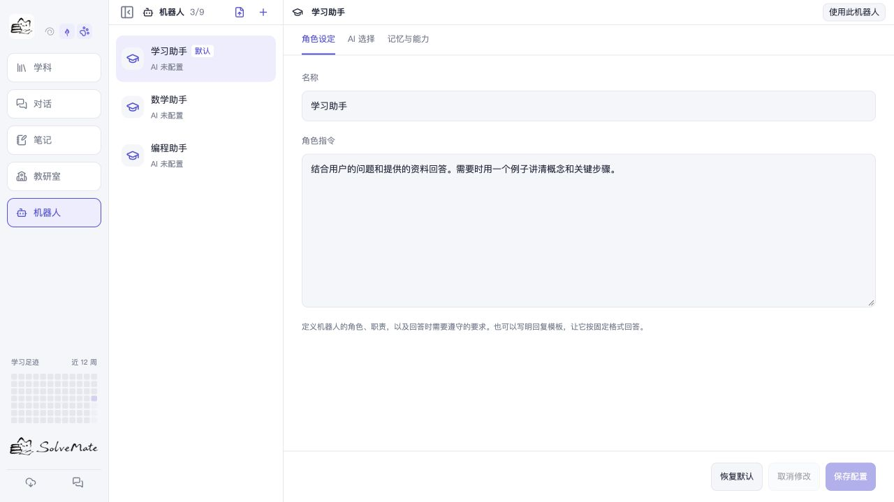
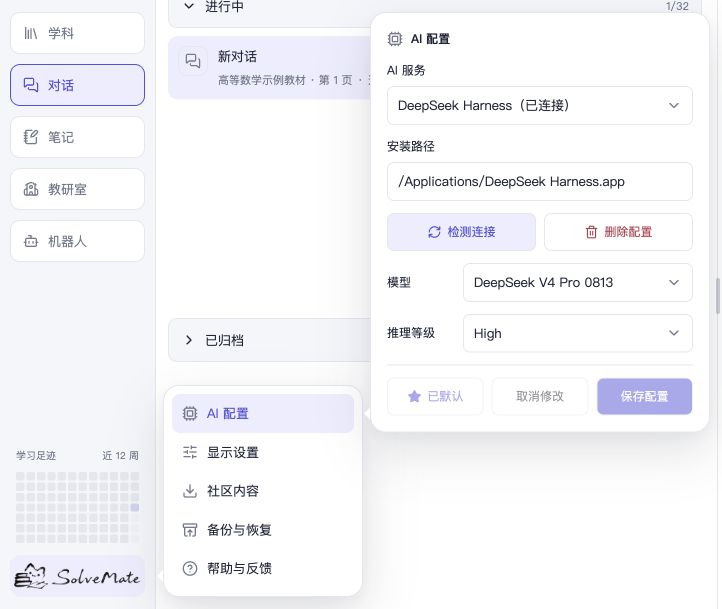

# SolveMate 用户手册

## 1. 主要界面

从左侧菜单切换页面，点击底部标志打开「系统设置」。拖动分隔线可调整阅读栏和对话栏的宽度。

### 学科

浏览学习资料和题目，或上传 PDF、PPTX。提问可以引用当前页、指定页码或选段。阅读栏的「相关内容」可以打开与这份资料关联的对话和笔记。

### 对话

左侧管理对话，右侧用页签切换。「返回阅读」同时打开原来的资料位置和对话。「返回教研室」可继续教研室中的对话。

### 笔记

阅读资料或聊天时，选中文字即可加入笔记。按笔记本浏览和编辑笔记，点击条目旁的来源图标可查看原资料或对话。同一笔记本内可以多选合并笔记，右键笔记本可导出 PDF。

### 教研室

选好资料和工具，在对话栏说明要整理的讲义、生成的练习或分析的错题。Skill 和输出模板可分别编辑，修改后另存为自定义工具。

### 机器人

设置机器人的名称、角色指令和使用的 AI，也可以导入或导出配置。已保存的机器人可在对话栏选择。

## 2. 主要配置

### 连接 AI 服务

在「系统设置 → AI 配置」选择本机已配置的 AI 服务，点击「检测连接」。如提示填写安装路径，填好后再检测。连接成功后选择模型，点击「保存配置」。要让新对话默认使用这个模型，点击「设为默认」。

只想调整当前对话时，打开对话栏右上角的「AI 选择」，从已连接的服务中选择模型。模型支持推理等级时，也可以在这里调整。

### 调整显示

在「系统设置 → 显示设置」切换白天、夜间模式和色调。对话字号通过对话栏上方的「Aa」调整，PDF 则用阅读栏底部的缩放控件。

## 3. 社区内容

在「系统设置」打开「社区内容」，点击气泡顶部的「社区内容」。上方的「资料库」提供学习资料和题目，下方的「工具库」提供教研工具。下载后的资料和题目可以在「学科」中打开，工具可以在「教研室」中选择。

点击「检查更新」查看结果。弹窗中的「更新」会依次更新检测到的条目，也可以点「确定」关闭后，在卡片上单独更新。卡片上的「社区更新」显示对应版本的发布日期。

如果需要连接其他社区内容服务，修改气泡里的「地址」后点击「保存」。要改回内置地址，点击「恢复默认」，再点击「保存」。「软件官网」可直接打开官网。

## 4. 数据与备份

资料、对话、笔记和配置保存在本机。在「系统设置 → 备份与恢复 → 用户数据」可以查看实际保存位置。

要**更改路径并迁移数据**，选择一个空文件夹，勾选「将现有数据复制到新目录」并保存路径。桌面版退出并重新打开后生效，网页版需要重启本机服务并刷新页面。

在「备份文件」中点击「导出备份」，保存 ZIP 文件。

点击「恢复备份」，选择 ZIP 文件并确认。**恢复会替换当前资料和记录。** 应用会先备份当前数据。

第三方 AI 的登录信息和会话由各服务单独保存。换电脑后，需重新登录并连接 AI 服务。
