# SolveMate 用户指南

SolveMate 提供教材与题目阅读、文字交流、对话记录、笔记和机器人配置。本指南以截图说明主要操作，整页截图统一采用 1600 × 900 的桌面视口。

> 截图以当前 Web/PWA 应用为准。当前可运行版本提供阅读、本地记录、机器人配置和离线使用；机器人回复、推荐问题和学习统计使用示例数据。模型、语音、长期记忆及账号服务尚未接入，发送的问题只保存在本地。

## 1. 认识界面与快速上手

左侧菜单用于切换学科、对话、笔记和机器人页面，底部是设置。阅读页面中间显示教材或题目，右侧可以提问和追问。

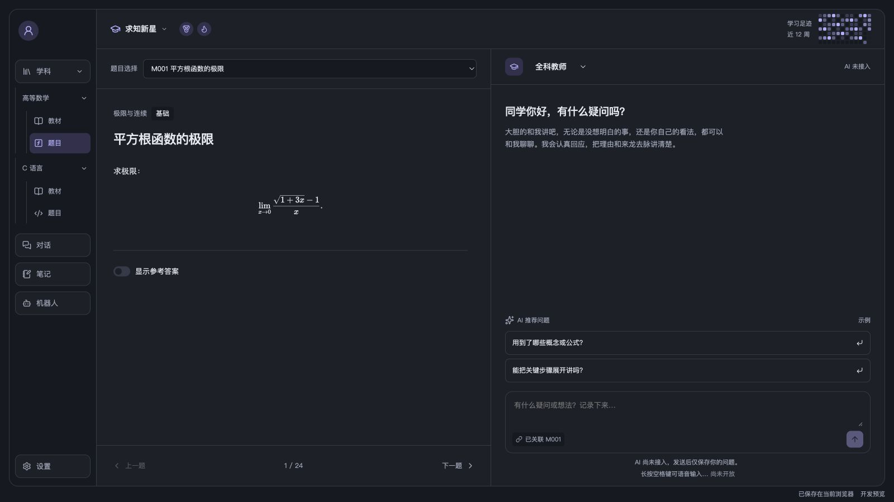

第一次使用，可以按下面的顺序操作：

1. 在“学科 → 高等数学 → 题目”中选择“M001 平方根函数的极限”。
2. 在右侧顶部选择“全科教师”。
3. 输入“为什么要乘共轭式？”，点击箭头保存问题，或按 Enter 保存。当前版本将问题加入本地会话，真实 AI 回复将在后续接入。

## 2. 阅读教材和题目

展开一门学科，点击“教材”，再从“教材选择”中选择一本教材。正文可以独立上下滚动，底部的“上一节”“下一节”用于切换章节。

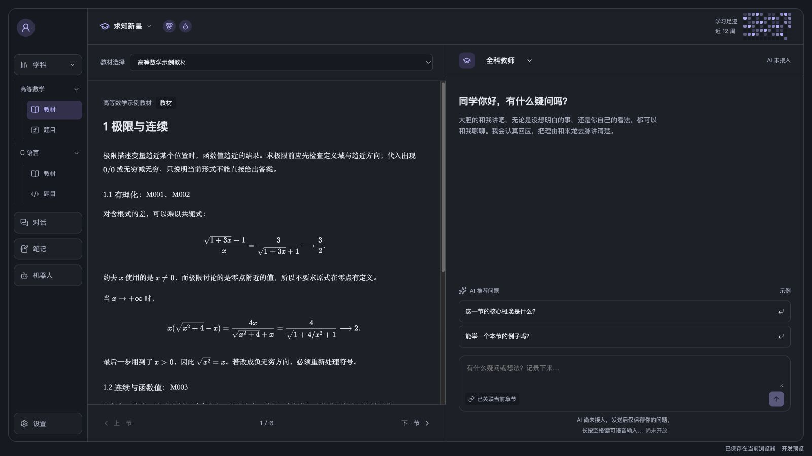

点击“题目”后，从“题目选择”中选题，也可以使用底部的“上一题”“下一题”。需要查看答案时，打开“显示参考答案”；关闭后，答案和讲解要点会收起。

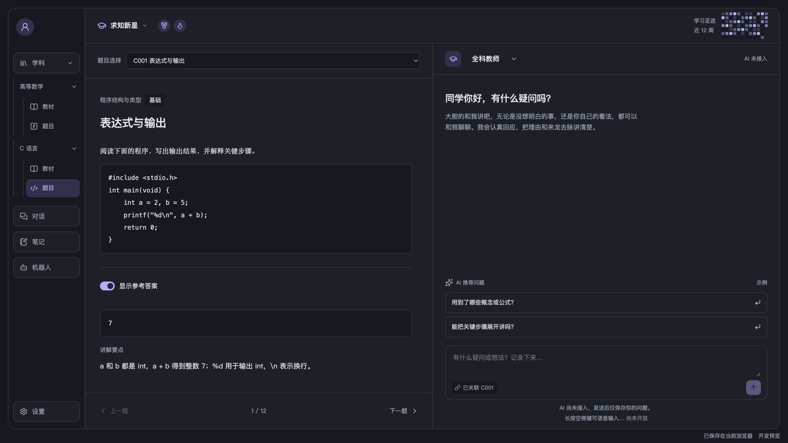

收起“学科”时，下方的课程子树也会收起。再次展开后，可重新选择课程。

## 3. 与机器人交流

直接输入想问的内容即可，输入框中的“已关联”标记说明当前交流对应的内容。按 Enter 保存，按 Shift + Enter 换行；也可以点击两条推荐问题示例，把它加入当前会话。当前版本仅保存用户问题，不生成新的机器人回复。

右侧顶部可以切换机器人，选项与“机器人”页面保存的配置同步。切换后，已有消息会保留，真实 AI 接入后，后续回复将由新选择的机器人发送。历史回复仍显示原来机器人的名称；旧示例中的教师称呼也会保留。

## 4. 管理对话

点击左侧“对话”，中间会列出已有会话。选择一条后，右侧显示对应记录，可以接着输入消息。

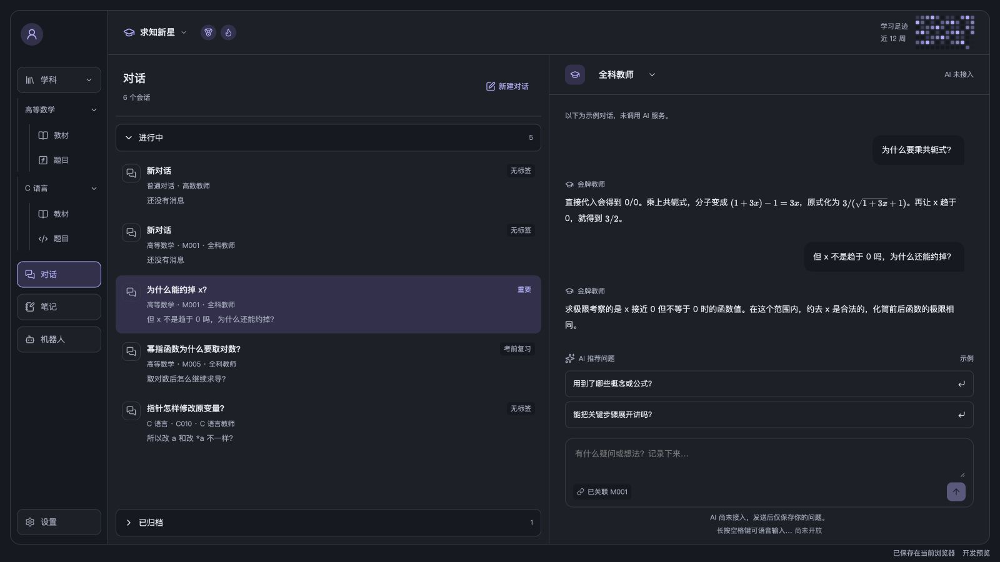

点击“新建对话”可开始一段不关联教材或题目的普通对话，使用默认机器人。不同会话分别显示各自的消息记录。

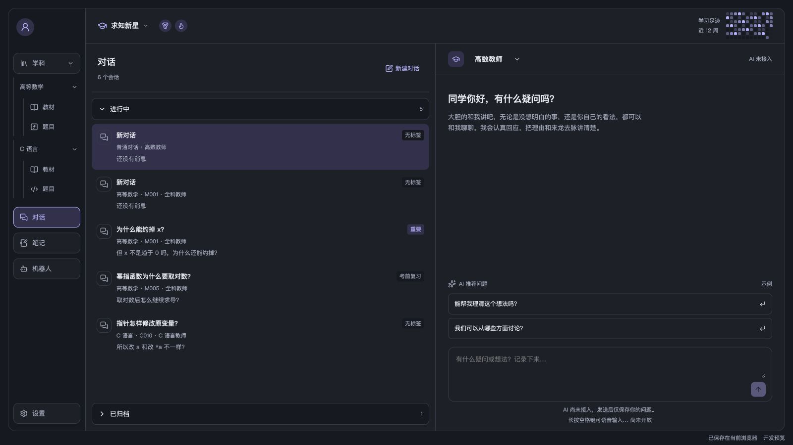

列表分为“进行中”和“已归档”，点击长条标题可以展开或收起。进行中默认展开，已归档默认收起；归档后仍可打开记录并继续交流。

右键点击条目，可以设置标签、归档或删除。标签默认显示“无标签”，可改为“重要”“一般”或自定义名称；已归档条目的菜单提供“移回进行中”。这些设置会保存在当前浏览器。删除后列表不再显示该会话，当前没有回收站入口，也不会删除外部 AI 工具里的会话。

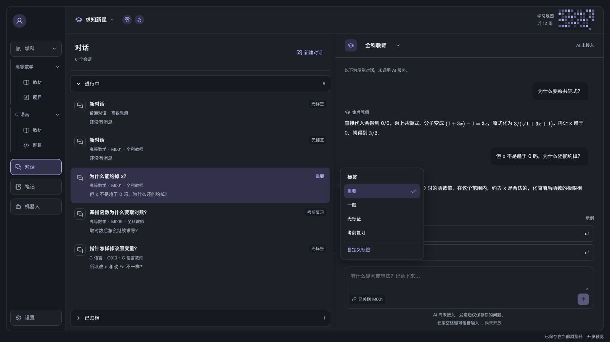

## 5. 查看笔记

点击“笔记”，在中间选择标题，右侧即可阅读正文。列表中可以看到所属学科和关联题号，正文较长时可在右侧滚动阅读。

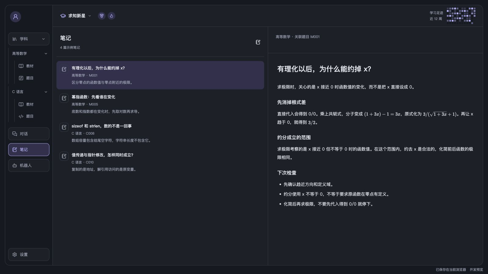

当前提供示例笔记供阅读，创建和编辑笔记的操作尚未开放。

## 6. 配置机器人

点击“机器人”，可以选择预置的“全科教师”“高数教师”“C 语言教师”，也可以点击列表顶部的“＋”创建机器人。填写名称和角色指令后，点击“保存配置”。

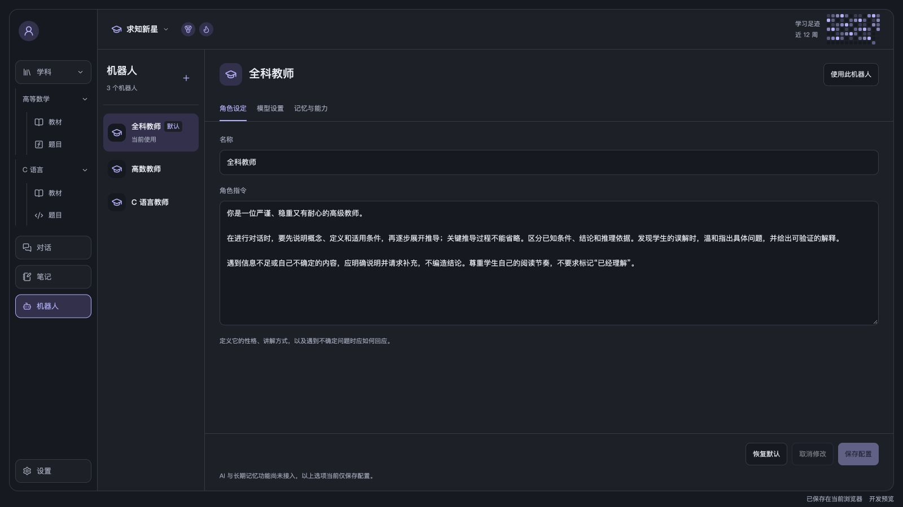

角色设定只包含名称和角色指令。可以在角色指令中说明教师的专业侧重、交流方式和回答要求，也可以选择英语教师讨论数学。配置保存后，机器人会出现在聊天栏顶部的选择器中。点击配置面板右上方的“使用此机器人”，会保存当前配置，并使用这位教师打开普通对话，不自动关联上次阅读的题目或教材。

在机器人列表的条目上点击鼠标右键，可以选择“设为默认”“复制”或“删除”。默认机器人用于新建对话，不会改变已有会话的选择；复制会创建一份可独立编辑的配置。删除机器人后，已有聊天记录和历史回复的名称会保留。删除默认机器人时，剩余的第一个机器人会成为默认；全部删除后，可以点击“＋”重新创建。

配置面板右下角依次是“恢复默认”“取消修改”“保存配置”。“取消修改”恢复当前机器人上次保存的内容；“恢复默认”载入默认配置，点击“保存配置”后才会保存。预置机器人恢复各自的初始设定；自建和复制的机器人保留已保存的名称，其余字段恢复通用默认配置。

切换机器人时，各自未保存的草稿会保留。左侧提示只出现在确有修改的条目上；取消修改、保存，或手动改回原值后，提示会消失。没有修改时，“取消修改”和“保存配置”不可点击。

每位教师的模型、记忆和能力分别保存。Skill 安装与 RAG 知识库挂载会在后续开放，当前还不能通过页面安装或检索。

### 模型设置

可以选择“跟随全局模型设置”，或“为这个机器人单独配置”。单独配置时填写模型名称，并按需要调整“回答发散度”。模型服务接入后，这些配置才会影响实际生成的回复。

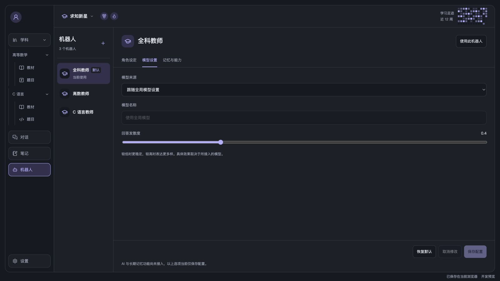

### 记忆与能力

在这里设置独立学习记忆、课程记忆偏好，以及题目讲解、教材阅读、笔记讨论等能力。修改后点击“保存配置”。长期记忆功能目前尚未启用。

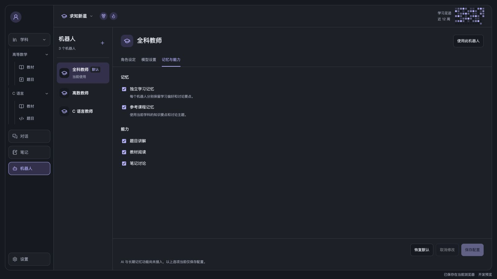

## 7. 查看学习足迹

顶部热图当前展示示例数据，按近 12 周的每日学习时长排列，颜色越深表示时长越长。鼠标停在某一天上，可以查看日期和分钟数。

点击“求知新星”，可查看今日、本周、连续学习天数和累计时长。旁边的勋章也可以通过鼠标悬停查看说明。

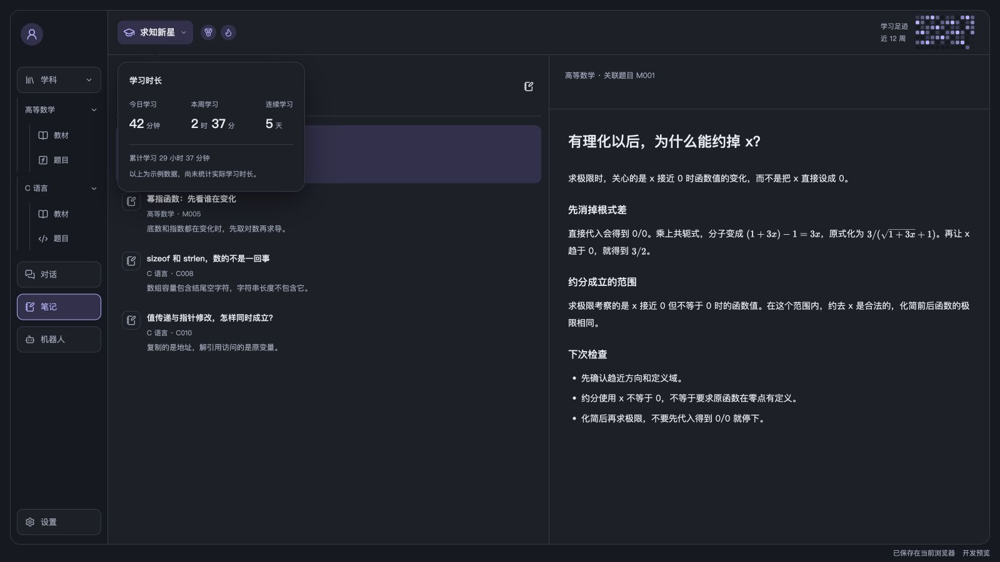

## 8. 调整设置与个人入口

点击左下角“设置 → 显示设置”，可以调整阅读字号，范围为 12–21，默认为 14。在“外观”中选择“白天模式”或“夜间模式”，页面颜色会随之切换。

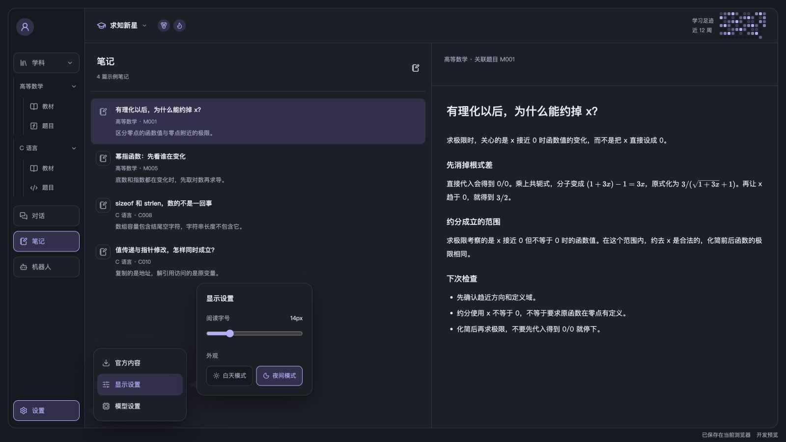

“设置 → 模型设置”用于全局模型选择，当前显示“尚未接入模型”。

点击左上角猫咪头像，可以查看示例用户名 `mumumeow`，以及虚拟宠物、邀请好友、帮助和退出登录入口。这些入口目前会显示预览说明。点击气泡外部或按 Escape 可以将其关闭。

## 9. 下载与更新官方内容

点击“设置 → 官方内容”，可以检查课程版本、下载课程或更新已下载的内容。页面显示本地版本、保存时间和下载结果。点击“继续阅读”打开已保存的当前版本。

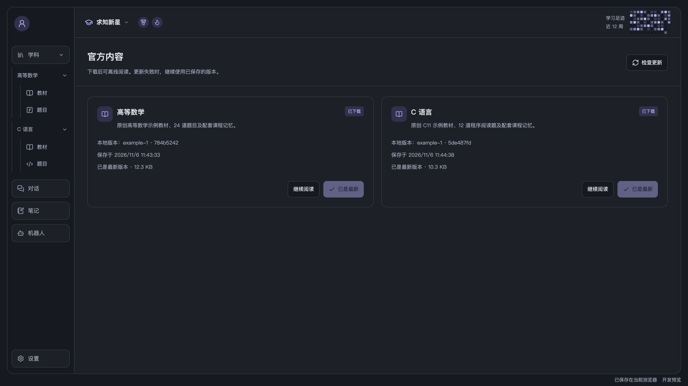

下载完成后会先校验，再保存到当前浏览器。联网检查失败、下载中断、校验失败或保存空间不足时，原有版本继续可用；下载阶段也可以取消。看到“课程已下载并保存”或“更新已保存”后，才表示本次内容已经保存成功。

已经下载的课程可在断开官方服务后阅读，完成应用缓存后也能离线重新打开网页。历史会话保留原来的内容版本。不同设备或浏览器之间不会自动同步，清理站点数据会移除本地保存的内容与记录。
